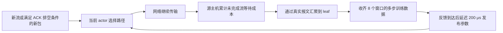

# Flow-A2C：使用未完成流成本的在线路由训练

日期：2026-09-17。本轮目标是在同一次传输过程中学习，并通过配对消融判断训练本身是否改善 P95/P99。原始数据目录：`/home/gengjiayao/ict/work/prisma_conweave_data/new_runs/flow-ac-20260917-s08jfocr`；修复基础设施问题后的正式实验位于其中的 `experiment/`。

**本轮实测完成：1,056 次独立正式运行、37,318,468 个流实例全部完成。** Flow-A2C 相对相同机制关闭学习的版本，P95 **-0.07%**、P99 **-0.16%**；相对冻结 CABLE，P95 **-0.06%**、P99 **-0.26%**；相对上一版 Online-QR，P95 **+1.17%**、P99 **+1.92%**。所有比例均为六类流量、两种拓扑等权汇总；负数表示延迟降低。

**结论：本轮不支持用 Flow-A2C 替换现有方案。** 学习开/关的 P95/P99 差异、相对旧 CABLE 的总体差异，其 95% bootstrap 区间都跨过零；相对 Online-QR 的两个指标则均变差。新版确实完成了传输期间的多步训练，但没有证实在线训练带来稳定的尾延迟收益。

All-to-All 是一个明确的收益来源例子：相对旧 CABLE，P99 下降 **15.52%**，但关闭学习后几乎不变；只保留新流初始选路的对照同样保留了这部分优势。因而这项改善不依赖在线参数学习，也不依赖流内重选。具体先验、预留量与概率选路各自的贡献，本轮没有继续拆分。

六类流量中，除 All-to-All 外，其余五类的 P99 均高于旧 CABLE，不能用接近持平的总体数字掩盖这些回退。完整图表和失败方向均保留在下文。

## 1. 与上一版的区别

上一版 Online-QR 根据采样包的 ACK 延迟，在线学习候选路径的分位数成本。ACK 延迟与整条流完成时间并不等价；上一轮结果中，相同机制关闭学习后仍保留了绝大部分收益。

本轮新控制器暂称 **Flow-A2C**，与旧 CABLE 和 Online-QR 分开命名。它使用多步 actor–critic：actor 选择路径，critic 估计后续成本；奖励来自主机上真实的未完成流等待时间，通过实际控制报文送到交换机。它不用仿真结束时才可知的 FCT 作为即时训练标签。

每个源 leaf 各有一个 actor、一个 critic。不同 leaf 收到相同全网成本，但不共享参数。当前实现不是 COMA、PPO、V-trace，也没有共享中央 critic 或反事实优势估计。



## 2. 奖励：先惩罚还没完成的流，再加重长时间等待

设源主机上流 i 的实际创建、完成时刻为 a_i、c_i。每 1 ms，主机对自己可观测的流生命周期累计三种成本：

```text
A = ∫ N_active(t) dt
E95 = ∫ N_active_and_age>tau95(t) dt
E99 = ∫ N_active_and_age>tau99(t) dt

cost = (A + 2*E95 + 4*E99) / (128 * 50 ms)
reward = -cost
```

积分在流创建、完成以及周期边界处精确计算，单位为 ns。完整生命周期内有：

```text
Σ A   = Σ FCT_i
Σ E95 = Σ max(FCT_i - tau95, 0)
Σ E99 = Σ max(FCT_i - tau99, 0)
```

因此原始项直接对应总完成时间，长流项对应超出固定阈值的等待量。**这不是 P95/P99 的恒等式**：减少这些成本不保证两个分位数一定下降，最终仍以独立测试测得的 P95/P99 为准。

阈值只用开发集固定评分基线确定：12 个开发条件各自 P95/P99 的几何均值，分别为 **4.756270 ms / 30.561736 ms**。它们是参考阈值，并不是所有开发流合并后的两个分位数，也不会用正式测试的尾延迟重新计算。

与完成时才给一次奖励相比，未完成流每个窗口都会产生成本。等待越久且超过阈值，成本越高；训练不必等最慢流结束。集合通信中尚未满足依赖、尚未创建的传输不计入活跃流；因此这个奖励也不等于作业完成时间，作业 CCT 必须另测。但全网成本仍混合了多个 leaf 的动作影响，不能自动解决信用分配问题。

## 3. 信息怎样到达学习器

源 NIC 在 RDMA queue pair 创建、完成处记录生命周期，不把流总大小交给模型。每个主机每 1 ms 发送一次 120 B 控制载荷，包含周期编号、截止时间、三个积分、当前活跃及超时流数、创建和完成计数。

源 leaf 收齐 16 台本地主机报告后聚合，再向其他 7 个 leaf 发送实际报文；远端聚合报告经 spine 到达目标 leaf。每个学习器收齐 8 个 leaf 的报告后才拥有该窗口的全网成本。ACK 奖励消融另把 leaf 已收到的采样 ACK 延迟总和与数量加入聚合包。

这些报文经过真实 NIC/交换机队列、链路传播和序列化，不直接读取其他主机或 leaf 的实时状态。运行脚本中的 `method="oracle"` 是旧接口标签；实际启用 `DIAG_FEEDBACK=1`，RL 模式会拒绝直接访问远端即时队列。报文在本模拟器中的计费尺寸为 **154 B**。每毫秒注入 128 个主机报告与 56 个 leaf 聚合报告，合计 **28,336 B / ms，即 226.688 Mbps 全网注入带宽**；按主机报告 1 跳、leaf 报告 2 跳计算为 **295.680 Mbps 的逐链路传输量总和**。这些数字不是某条链路的负载。原来的队列遥测开销另计。

本地主机链路上每台主机报告约占 1 Gbps 的 **0.1232%**。交换机聚合报文的链路分布由静态控制路径决定；它们使用高优先级队列，会与数据通信竞争资源。学习关闭对照保留完全相同的遥测机制。

当前报告协议没有重传机制。丢失必要报告会阻塞对应 rollout 更新；审计检查每个训练窗口的接收完整性，不会用全局模拟器值补齐。模型推理时延没有建模；训练发布延迟是配置预算，不能当作交换机硬件实测。

## 4. 状态、动作和初始化

每条候选上联对应 20 维 actor 输入：

- 原 Online-QR 的 12 个输入：常数、本地/已报告远端延迟、端口和目的 leaf 近期工作量、报告年龄与变化、两段链路序列化时间、近期路径预留量、候选路径延迟离散程度、是否已有远端报告。
- 8 个新增输入：源 leaf 首次看到该流以来的年龄、已发送字节、未确认字节、ACK 速率、距最近 ACK 时间、是否为当前路径、包间隔、最新收到的全网活跃流数。

连续值按源码中的固定尺度使用 tanh、log1p 或上限变换。源 leaf 观察到的流年龄与源主机应用层年龄不同。没有输入最终 FCT、最终流大小、尚未发生的流到达或未收到的反馈。

actor、critic 各是 20 输入、16 隐藏单元的 tanh 网络，每个网络 **352 个参数**。critic 的输入为常数、最近收到的 8 个全网统计量，以及最近已选路径特征的 11 个滑动平均。每次独立运行重置；同次运行的流量阶段、集合通信作业之间保留模型。

隐藏层初始权重来自标准差 0.15 的高斯分布，输出层和偏置为零。没有离线预训练；配置里的 `fixed.txt` 只满足已有模型加载接口，新候选选择由 `FlowActorCritic::Select` 接管。

动作是选择源 leaf 的一个有效上联端口。明确的固定先验仍然存在：

```text
base_ms = 0.008 + local_delay + 0.25*remote_delay
          + 0.1*port_work + reserved
logit(path) = -16*log(base_ms/0.02) + actor(state(path))
pi(path) = 0.99*softmax(logits)[path] + 0.01/number_of_paths
```

每次根据 pi 随机采样。预留量沿用按 200 μs 衰减的端口新流/迁移计数。这些机制是人工设计的先验，不能算作训练产生的收益。它们也可能很强，以至于 actor 的小幅修正难以改变最终表现；本实验专门保留关闭学习的控制组。

学习的 logit 不再使用 Online-QR 的固定输出裁剪区间；训练梯度和单次参数更新仍有稳定性限制，两者不能混为一谈。

## 5. 多步训练与发布时间

每 1 ms 记录一个 frame，包含当时模型版本、critic 状态和值、该窗口动作的 log-policy 梯度总和、动作数量。连续 **8 个窗口**内固定 actor、critic。窗口结束后等待全部所需反馈，额外延迟 **200 μs** 才发布新参数；数据包继续转发。

```text
gamma = exp(-1 ms / 200 ms)
G_end = V(state_at_rollout_end)
G_t = -cost_t + gamma*G_(t+1)
A_t = G_t - V(state_t)
```

将同一 rollout 内的优势减均值、按标准差归一化（标准差下限 0.01），加权各窗口保存的 log-policy 梯度，按训练动作总数归一化后更新 actor。critic 使用 Huber 残差，单样本残差梯度限制在 ±10。两者使用 Adam；梯度 L2 上限 10；单次 actor/critic 参数变化的 L2 上限分别为 **0.10 / 0.50**。critic 步长固定 0.01，actor 步长仅在开发集从 0.001、0.003、0.01 中选择，最终固定为 **0.003**。

接收/发布等待期间的动作仍使用当前模型，但不纳入下一批训练。发布后下一个完整 1 ms 窗口开启新 rollout。这保证每个训练批次只含同一行为策略版本，代价是部分动作没有训练梯度。报告分别统计总决策、纳入训练的决策和实际 actor 参数变化次数。

这是以 1 ms 为时间步的近似控制问题：同一窗口内多个动作共享窗口回报，8 ms 后的影响由 critic 估计。它没有逐动作反事实回报；全网奖励噪声和短 rollout 的估计偏差仍可能限制收益。

## 6. 训练与流内改路是两个不同开关

两个模式分别做学习开启/关闭配对：

- **Initial / on、Initial / off**：仅新流首次选路，之后整流保持。模型可以在业务传输期间更新，更新只影响后续新流。
- **Flow-A2C、Reselect / off**：新流选路；现有流的新包只有在此前已发字节全部被累积 ACK 覆盖、且距上次决策至少 50 μs 时，才能重新选择。控制器不主动暂停发包制造改路机会。

另有 **ACK-A2C**：相同架构、初始化、动作边界和控制报文，奖励改为每窗口全网已采样 ACK 延迟的均值，并沿用密集奖励开发集选出的同一步长。它检验本轮奖励目标的改变是否优于 ACK 代理目标。它与旧 Online-QR 的模型、优化器均不同，二者不能混为同一消融。

关闭学习版本同样采样动作、收集反馈、经历报告和计算延迟，但 actor、critic 权重始终不写入。比较这些配对组才能归因于在线训练；与旧算法的总差异还包括先验、概率选路和改路机会。

## 7. 预先固定的评测方案

开发流量种子 95101、95102，包含 uniform、storage、traffic shift，两种拓扑，共 12 个条件。基线校准 12 次；学习率开发实验 96 次，统一按两种路由模式、全部开发条件的 P95/P99 对数均值选择一个步长。

正式流量种子 **96101–96104**。所有设置在生成正式运行前冻结。正式测试包含六类流量、两类拓扑，共 48 个条件：

- uniform、storage：300 ms 到达流量，六个 50 ms 阶段。
- traffic shift：uniform/20% → mixed/50% → mixed_fast/35%，再重复一次；每阶段采用不同随机流量。
- bursty incast：20% → 50% → 35% 的三个同步突发阶段重复两次。
- All-to-All：32 个 rank，六个作业，间隔 150 ms；每对 rank 的大小交替为 8/64 KiB，每作业重新抽样主机与 rank 放置。
- Ring All-Reduce：32 个 rank、每 rank 1 MiB；六个作业，间隔 150 ms；reduce-scatter 与 all-gather 的传输由依赖 DAG 释放。没有 GPU 计算建模。

这些都是可复现的合成到达流量，不是生产网络抓包回放。Uniform 用 Poisson 到达，流大小为 2,000 / 8,000 / 64,000 / 256,000 B，概率为 0.50 / 0.35 / 0.10 / 0.05；Storage 的流大小取自仓库 AliStorage2019 CDF，再由流量生成器生成到达和端点。mixed/mixed_fast 使用含 1 MiB 大流的大小分布，并分别以 1–5 ms / 0.2–1 ms 改变热点机架。Bursty 每 0.5 ms 发起一批流，批内抖动 0–20 μs，一半概率汇聚到当批随机热点主机，大小为 4 / 32 / 512 KiB，概率 0.6 / 0.3 / 0.1。

拓扑均为 128 主机、8 leaf、8 spine，主机链路 1 Gbps。对称拓扑每 leaf 有 8×0.75 Gbps 上联；非对称为 4×1 Gbps + 4×0.5 Gbps，总上联均为 6 Gbps。所有方法使用相同 DCQCN、IRN、关闭 PFC、50 MiB 缓冲及低速 ECN 设置。

正式方法共 14 个：ECMP、WECMP、DRILL、CONGA、LetFlow、ConWeave*、原固定评分、冻结 CABLE、Online-QR，以及本轮五个组。CABLE 使用 3 个既有训练模型；Online-QR 和本轮各组使用 2 个初始化/探索种子；其余各一次。共 **1,056 次正式运行**。

`ConWeave*` 沿用此前的低速适配参数：额外回复期限 200 μs、发送到期 1000 μs、路径暂停 16 μs、额外 VOQ 刷新 64 μs、默认 VOQ 等待 400 μs、状态保留 2 s。本轮不重新为各基线搜索参数。

包含冷启动期的所有流均计入 P95/P99。正式测试中的在线学习只读取已经收到的反馈，这是评测对象本身；不允许用最终测试结果挑步长、改奖励或挑选好看的场景。结果按场景/拓扑等权的配对对数比汇总；bootstrap 以流量种子和模型种子为单位，不把数百万条相关流当作独立样本。仅 4 个流量种子，区间不能解释成广泛部署保证。

## 8. 实现和验证记录

- 新控制器：[flow-actor-critic.h](../conweave-ns3-main/src/point-to-point/model/flow-actor-critic.h)、[flow-actor-critic.inc](../conweave-ns3-main/src/point-to-point/model/flow-actor-critic.inc)。
- 运行与因果审计：[flow_ac_evaluation.py](../prisma/scripts/flow_ac_evaluation.py)。
- 汇总绘图：[analyze_flow_ac.py](../prisma/scripts/analyze_flow_ac.py)。
- 原生梯度、流编号回归：[check_flow_ac_native.py](../prisma/scripts/check_flow_ac_native.py)。MLP、混合探索策略的梯度最大数值差分别为 3.35e−11、3.60e−10。
- 第一轮 7,145 条流的总 FCT 为 5,384,164,674 ns，与主机累计积分逐纳秒一致。
- 正式审计逐运行检查源生命周期、FCT 总和和超阈值成本；检查收到的报文字段、8 个 leaf 聚合完整性、反馈时间、200 μs 发布延迟、策略版本、冻结参数和 ACK 安全重选边界。
- 功能测试 20 组已全部通过；修复后的校准 12 组已全部通过。额外独立核对了所有功能测试的多步回报递推和优势符号；Storage 与 All-Reduce 样例的 458,496 个主机窗口积分也独立重算并逐项相等。
- 8 对学习开/关运行在第一次 actor 更新前的所有决策完全一致；两次原生重放的 FCT、参数、决策、奖励和接收日志均逐字节一致。
- 扩展为 300 ms 后发现并修复原有 `FlowIDNUMTag` 序列化错误：32 位流编号原先按 16 位写入，超过 65,535 后重复。改为 32 位序列化，并初始化 size 字段；该 tag 属于模拟器元数据，不增加线上报文尺寸。旧失败记录保留在根目录，正式数据使用 `experiment/` 内统一修复后的二进制。
- 修复前后重放旧 ECMP、ConWeave、CABLE、Online-QR 场景，FCT 与诊断输出均逐字节相同。

本轮只评测零输出层冷启动的短期在线学习：持续注入流量为 300 ms，集合通信为六个作业。没有评测长期连续运行或离线预训练后的在线微调，不能据此否定这些设置中的学习收益。

本实现仍把 flow 状态保留到一次运行结束，没有给出长期部署的内存回收方案；没有模拟模型推理开销，也没有验证交换机上运行神经网络的硬件能力。报告本轮仿真结论时保留这些边界。

## 9. 正式结果：先看训练本身，再看算法总效果

正式评测的 1,056 次运行全部完成，因果、奖励和完整性审计全部通过。开发集和测试集分离，正式测试过程中没有重新调参。

### 9.1 在线学习本身的收益

- 允许 ACK 安全重选，学习开启相对关闭：P95 -0.07%（95% bootstrap 区间 -0.42% 至 +0.27%）；P99 -0.16%（95% bootstrap 区间 -0.52% 至 +0.31%）。
- 只选初始路径，学习开启相对关闭：P95 +0.07%（95% bootstrap 区间 -0.28% 至 +0.30%）；P99 +0.27%（95% bootstrap 区间 -0.25% 至 +0.87%）。

Flow-A2C 相对相同架构 ACK 奖励版本：P95 **-0.11%**、P99 **+0.08%**。按本轮实际优化的加权等待成本比较，学习开/关的变化为 -0.02%（95% bootstrap 区间 -0.18% 至 +0.14%）。这些是不同指标，不能把奖励目标的改善直接当作 P99 改善。


关闭学习时，允许安全重选相对只选初始路径的总体 P95/P99 为 **+0.21% / +0.49%**。这说明本轮的流内重选本身也没有带来总体优势。

### 9.2 与现有算法的总体比较

- 相对 ECMP：P95 **-45.71%**、P99 **-49.81%**。
- 相对 WECMP：P95 **-35.78%**、P99 **-36.33%**。
- 相对 DRILL：P95 **-72.15%**、P99 **-68.23%**。
- 相对 CONGA：P95 **-53.57%**、P99 **-49.73%**。
- 相对 LetFlow：P95 **-48.04%**、P99 **-45.25%**。
- 相对 低速适配 ConWeave：P95 **-32.47%**、P99 **-29.81%**。
- 相对 原固定评分：P95 **-0.25%**、P99 **-0.05%**。
- 相对 冻结 CABLE：P95 **-0.06%**、P99 **-0.26%**。
- 相对 Online-QR：P95 **+1.17%**、P99 **+1.92%**。

完整场景图保留所有正负结果；蓝色为 Flow-A2C 更快，红色为更慢，颜色以 0 为中心。


### 9.3 六类流量分别看

- **Uniform**：相对关闭学习，P95/P99 +0.02% / -0.27%；相对冻结 CABLE，+4.03% / +4.61%。
- **Storage**：相对关闭学习，P95/P99 -0.20% / -0.31%；相对冻结 CABLE，+3.05% / +4.63%。
- **Traffic shift**：相对关闭学习，P95/P99 -0.24% / +0.26%；相对冻结 CABLE，+2.08% / +2.98%。
- **Bursty incast**：相对关闭学习，P95/P99 +0.16% / -0.05%；相对冻结 CABLE，+1.55% / +0.98%。
- **All-to-All**：相对关闭学习，P95/P99 -0.00% / +0.00%；相对冻结 CABLE，-5.13% / -15.52%。
- **Ring All-Reduce**：相对关闭学习，P95/P99 -0.19% / -0.57%；相对冻结 CABLE，-5.48% / +2.39%。

绝对延迟图使用明确标注的对数纵轴；点为几何均值，线段为全部种子的最小到最大范围。相对值图与绝对值图共同展示，避免仅凭坐标范围判断改进。


### 9.4 集合通信的作业完成时间

- All-to-All 的作业 CCT：相对关闭学习 +0.02%（95% bootstrap 区间 -0.06% 至 +0.09%）；相对冻结 CABLE -14.58%（95% bootstrap 区间 -18.77% 至 -11.89%）。
- Ring All-Reduce 的作业 CCT：相对关闭学习 -0.11%（95% bootstrap 区间 -0.72% 至 +0.39%）；相对冻结 CABLE -2.12%（95% bootstrap 区间 -2.56% 至 -1.52%）。

流级尾延迟与作业 CCT 分开评估，不能用其中一个代替另一个。


## 10. 模型确实在传输过程中学习了吗

是。Flow-A2C 的 96 次正式运行中，共发布 42,960 次 actor/critic 更新，其中 22,845 次实际改变 actor 参数；768/768 个 leaf 在最后一次路由决策前已经发布更新。

总路由决策 6,167,947 次，其中 5,503,498 次进入完整训练 rollout（89.23%）；5,965,556 次发生在首次实际 actor 更新之后。实际路径变化 2,754,368 次，不能把更新次数当作改路次数。关闭学习组参数更新为 0。

部分发布发生在无新路由动作的窗口，只更新 critic。所有流结束后额外等待 11 ms，让最后的报告和更新落盘；这不会改变已完成流的 FCT，但总控制字节计数包含这段刷新时间。


图中示例预先固定为第一个正式流量种子、初始化种子 0、非对称拓扑的 shift 和 All-Reduce，并非挑选表现最佳的运行。actor 距离相对于第一次发布后的参数，避免把随机隐藏层的初始范数当作学习量。

## 11. 学习到底改变了多少策略

对六类流量分别选择预先固定的第一个测试种子、初始化种子 0、非对称拓扑，从候选状态和历史选路记录重建固定先验，再与当时实际策略比较。关闭学习时，重建策略与原生策略的差异均仅为日志浮点精度误差。

- Uniform：学习项改变最高概率候选的决策占 **0.208%**；平均策略总变差距离为 **0.00176**。
- Storage：学习项改变最高概率候选的决策占 **0.130%**；平均策略总变差距离为 **0.00106**。
- Traffic shift：学习项改变最高概率候选的决策占 **0.212%**；平均策略总变差距离为 **0.00148**。
- Bursty incast：学习项改变最高概率候选的决策占 **0.206%**；平均策略总变差距离为 **0.00143**。
- All-to-All：学习项改变最高概率候选的决策占 **0.459%**；平均策略总变差距离为 **0.00193**。
- Ring All-Reduce：学习项改变最高概率候选的决策占 **0.516%**；平均策略总变差距离为 **0.00116**。

总变差距离是两组候选概率差的绝对值之和的一半，取值 0–1。这里比较的是同一已发生状态上的学习策略与固定先验；最高概率候选不是每次随机采样的实际动作。这项诊断不能替代完整的学习开/关性能对照。

[完整策略审计](/home/gengjiayao/ict/work/prisma_conweave_data/new_runs/flow-ac-20260917-s08jfocr/formal-policy-audit.json)与[重建脚本](../prisma/scripts/audit_flow_ac_policy.py)保存了逐样例统计。

这轮实现解决了反馈来源、在线更新时序和多步目标的核验问题。收益判断仍应以第 9 节的配对消融为准。代码与上述诊断提示三个仍需解决的限制：

1. **固定先验很强。** 初始 logit 为 `-16*log(base)`，学习网络负责附加修正。即使取消了旧版的预测值裁剪，也不代表模型会大幅改变候选概率。
2. **全网回报的信用分配仍粗。** 多个 leaf、同一窗口内多个动作共享回报，回报还包含当前选路无法改变的等待。当前 critic 不是逐动作的反事实基线。
3. **实际学习时间有限。** 每个 rollout 只有 8 ms，持续注入场景只有 300 ms；更远的影响依赖 critic 估计，报告和发布等待期的动作没有进入训练批次。长时间运行、较好的初始模型和更精细的信用分配尚未验证。

后两点是基于实现的解释，尚未通过单独改变它们的消融证明因果强弱。因此，这轮结果不支持“只要边传输边训练就能适应任意流量并稳定胜出”。

## 12. 复现入口

```bash
python3 prisma/scripts/flow_ac_evaluation.py --experiment-dir /path/to/new-experiment --phase calibrate --workers 24
python3 prisma/scripts/flow_ac_evaluation.py --experiment-dir /path/to/new-experiment --phase smoke --workers 24
python3 prisma/scripts/flow_ac_evaluation.py --experiment-dir /path/to/new-experiment --phase dev --workers 24
python3 prisma/scripts/flow_ac_evaluation.py --experiment-dir /path/to/new-experiment --phase main --workers 24
python3 prisma/scripts/analyze_flow_ac.py --experiment-dir /path/to/new-experiment --output-dir /path/to/figures
```

运行器首次初始化会从当前 `build-cable` 冻结二进制及 point-to-point/network 库；先按本机 ns-3 构建环境编译。完整原生配置保存在每个运行目录，可直接用其冻结二进制重放。上述脚本沿用仓库既有基础模型/拓扑路径，换机器时须同步对应基础数据或调整 `BASE`。

- [完整汇总与置信区间](/home/gengjiayao/ict/work/prisma_conweave_data/new_runs/flow-ac-20260917-s08jfocr/analysis/summary.json)
- [正式运行清单和逐运行结果](/home/gengjiayao/ict/work/prisma_conweave_data/new_runs/flow-ac-20260917-s08jfocr/experiment/main-results.json)
- [预先冻结的协议](/home/gengjiayao/ict/work/prisma_conweave_data/new_runs/flow-ac-20260917-s08jfocr/experiment/protocol.json)与[学习率选择](/home/gengjiayao/ict/work/prisma_conweave_data/new_runs/flow-ac-20260917-s08jfocr/experiment/selection.json)
- [原生数值检查](/home/gengjiayao/ict/work/prisma_conweave_data/new_runs/flow-ac-20260917-s08jfocr/native-checks/results.json)、[配对初始化审计](/home/gengjiayao/ict/work/prisma_conweave_data/new_runs/flow-ac-20260917-s08jfocr/matched-initialization-audit.json)、[确定性重放](/home/gengjiayao/ict/work/prisma_conweave_data/new_runs/flow-ac-20260917-s08jfocr/deterministic-replay.json)
- [全部图表及 PDF](/home/gengjiayao/ict/work/prisma_conweave_data/new_runs/flow-ac-20260917-s08jfocr/analysis)
