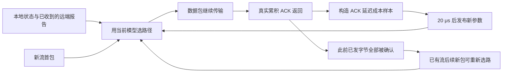

# 在线路由重设计：传输期间学习与 P95 / P99 对照

日期：2026-09-17。原始数据根目录：`/home/gengjiayao/ict/work/prisma_conweave_data/new_runs/cable-online-20260917-ylfvt5ht`。

**实测结论：真正的在线训练已经实现，但学习本身的收益仍然有限。** 1,152 次独立测试全部完成。六类流量、两类拓扑等权汇总后，新版相对旧 CABLE 的 P95 / P99 分别下降 **1.10% / 2.08%**；相对相同机制、关闭学习的版本，P95 为 **+0.12%**（区间跨零），P99 为 **−0.50%**。总体收益主要出现在集合通信，四类持续注入流量反而都比旧 CABLE 略慢。结果支持“已实现并验证边传输边训练”，不支持“在线 RL 能适应任意流量并稳定胜出”。

## 1. 这次改变了什么

新控制器暂称 **Online-QR**，避免把不同训练目标的新实现混称为原来的 CABLE。它在每个源 leaf 上独立学习：数据包经过 leaf 后，真实传输 ACK 返回，控制器获得一次延迟反馈，随后在**同一次仿真、业务仍在传输时**更新参数。后续选路读取最新参数。它不等待整批流完成，不依赖 Python 在两次完整仿真之间改模型。

原 CABLE 保留为基线：三个离线训练的冻结模型、首次选路、整流保持。原模型及论文结果没有被本实验覆盖。

Online-QR 是带分位数成本预测的**在线 contextual bandit（上下文老虎机）**。动作是路径，反馈是该动作对应的 ACK 延迟成本。它属于在线决策学习，但没有 DQN 的下一状态 bootstrap、长期折扣回报或经验回放，不应在论文中写成新 DQN。在线更新提供适应流量变化的能力，是否改善 FCT 必须由独立测试和关闭学习的对照证明，不能由“在线”二字推导出适应任何场景。



## 2. 状态、动作、反馈和更新

### 2.1 谁学习、谁执行

每个源 leaf 有三个线性预测头，分别学习 ACK 延迟相对固定先验的 50%、95%、99% 分位数。每头 12 个系数，共 36 个可训练系数。所有系数从零开始，不使用旧 CABLE 的训练参数；leaf 之间不共享模型。一次独立运行开始时模型重置，同一次运行的流量阶段和集合通信作业之间持续保留模型。

配置里仍有 `RL_SWITCH_MODEL=fixed.txt`，这是为复用原生选路模块的加载接口。启用 `ONLINE_ENABLE=1` 后，候选评分和端口选择由 `OnlineRouting::Select` 覆盖，实际学习参数来自上述零初始化模型，不能把该文件误认为在线算法预训练的模型。

路径状态来自本地端口和已收到的远端报告。远端信息仍通过真实的 194 B / 200 μs 反馈报文传播，并按既有实现量化；模型不读取远端即时队列、未发生的 ACK、最终 FCT 或流的最终大小。ACK 学习不另发奖励报文。

### 2.2 输入状态

每条候选上联分别构造以下 12 个输入。时间特征先转换为 ms，再按代码中的常数缩放；这里只用表格说明字段，不用表格展示实验性能。

| 输入 | 含义与变换 |
|---|---|
| 常数 | `1`，预测头偏置 |
| 本地延迟估计 | 本地排队量加 1000 B 的序列化时间，`tanh(local_delay / 0.05)` |
| 已收到的远端延迟估计 | 已报告排队量加 1000 B 的序列化时间，`tanh(remote_delay / 0.05)` |
| 本端口近期服务工作量 | `tanh(port_work / 0.05)` |
| 目的 leaf 近期工作量 | `tanh(destination_work / 0.05)` |
| 远端报告年龄 | `min(2, report_age / 0.2)` |
| 远端延迟变化 | `tanh(remote_change / 0.05)` |
| 本地链路序列化时间 | `min(2, local_serialization / 0.016)` |
| 远端链路序列化时间 | `min(2, remote_serialization / 0.016)` |
| 最近选路留下的预留工作量 | `tanh(reserved / 0.05)` |
| 候选路径延迟的标准差 | `tanh(path_spread / 0.05)` |
| 是否已有远端报告 | `0` 或 `1` |

预留工作量根据该 leaf 最近分配到端口的新流和实际迁移计算。计数按 200 μs 时间常数指数衰减，再乘该端口发送一个 1000 B 包的序列化时间。它是明确的人工先验，不能当作学习产生的能力。

### 2.3 动作与选路评分

动作是选择当前源 leaf 的一个物理上联端口。先计算固定延迟先验：

```text
base_ms = 0.008 + local_delay + 0.25 * remote_delay
          + 0.1 * port_work + reserved
```

三个预测头输出 `q50, q95, q99 = w · x`。评分时把各输出截断到 `[-1.5, 1.5]`，再用 `max` 保证 `q95 ≥ q50`、`q99 ≥ q95`：

```text
score = base_ms * exp(0.2*q50 + 0.4*q95 + 0.4*q99)
```

通常选择最低分端口。2% 的决策进行探索，但只在评分不超过当前最优值 1.25 倍的端口中随机选。这个限制减少明显较差路径上的探索，并不构成性能保证。相同流量分别使用三个探索种子；关闭学习的对照使用相同种子。

### 2.4 reward 从哪里来

源 leaf 对经过的数据包做被动采样：同一条流同时最多保留一个未完成样本，两次探测起点至少间隔 50 μs。重传包不作为新样本的起点。当返回的累积 ACK 覆盖被采样数据包的末尾序号时，得到 `data-to-ACK latency`。

```text
target_cost = clip(log(max(0.001 ms, data_to_ACK_ms) / base_ms), -4, 4)
```

若使用 reward 表述，就是最小化该成本或最大化它的负值。代码直接拟合成本的三个分位数，**没有使用整条流完成时间作为在线训练标签**。ACK 延迟包含数据路径、接收侧和 ACK 返回路径的影响；P95/P99 ACK 延迟不是 P95/P99 FCT，两者相关但不等价。这是本设计需要通过实验验证的代理目标。

每个样本保留最近一次选路时的状态和先验。同一路径上的后续探测仍使用最近的决策状态；它不会对每个采样包重新读取完整状态。因此，长流的早期状态可能变旧，这也是当前实现的限制。

### 2.5 参数何时改变

每个 leaf 每 20 μs 最多接受一个更新样本，额外样本被跳过。ACK 到达后再延迟 20 μs 发布更新，不阻塞数据包转发。该时延是显式的仿真计算预算，不是测得的交换机训练耗时。

对每个分位数 `τ ∈ {0.5, 0.95, 0.99}`，执行一次归一化 quantile Huber 更新：

```text
error = target_cost - dot(w, x)
g = (τ - indicator(error < 0)) * min(1, abs(error)/0.5)
w_i = clip(w_i*(1 - step*0.001)
           + step*g*x_i/(1 + sum(x_j*x_j)), -2, 2)
```

学习步长仅在开发集从 `0.005 / 0.02 / 0.08` 中选择，正式测试固定为 **0.08**。损失形式借鉴分位数回归，不意味着实现了 [QR-DQN](https://arxiv.org/abs/1710.10044)；动作反馈结构更接近 [contextual bandit](https://arxiv.org/abs/1003.0146)。

### 2.6 一条流传到一半能否改路

**可以，但有明确边界。** 后续新包到达时，只有该流之前发出的字节全部已被源 leaf 观察到的累积 ACK 覆盖，而且距上次选路至少 50 μs，才能重新选路。未满足条件就继续使用原路径；控制器不主动暂停发送来制造改路机会。

因此，“边传输边训练”不等于“每个包都换路”。参数可以持续更新而某条忙碌长流一直没有安全改路机会；Ring All-Reduce 尤其可能主要通过后续新流使用新模型。审计分别记录参数更新、重新决策和实际路径变化，不把三者混为一谈。

## 3. 怎样避免训练集和测试集混在一起

开发集使用种子 **92001–92002**，流量只包含 uniform、storage 和 traffic shift，并同时包含两种拓扑。72 次开发运行覆盖三个学习步长及固定评分、旧 CABLE、关闭学习对照；步长按所有开发条件的 P95/P99 对数均值选择。

正式测试使用独立种子 **93001–93006**。bursty incast、All-to-All 和 Ring All-Reduce 这三个工作负载族从未用于步长选择。先生成并保存 `selection.json`，再生成正式测试输入；正式测试不改步长、初始化、特征或规则。

在线学习在测试过程中读取**已经收到**的 ACK 是算法的正常工作方式，并不是用测试结束后可知的答案训练。同一条决策只能使用发布时刻不晚于它的模型。所有流，包括零参数冷启动时的流，都纳入测试指标，不单独删除预热阶段。

这仍是有限的在线评测：不能把六类模拟流量称为所有流量，也不能把六个种子解释成任意网络上的泛化保证。

## 4. 对照方法与公平条件

正式测试比较 ECMP、WECMP、DRILL、CONGA、LetFlow、低速适配 ConWeave、原固定评分、三个冻结 CABLE 模型、Online-QR 和关闭学习的 Online-QR。共十种方法，其中 CABLE、Online-QR、关闭学习各运行三个模型或探索种子。

关闭学习版本保持同样的零初始化、固定先验、状态输入、探索概率、ACK 采样、反馈开销和流内重选边界，只禁止写入新权重。**新方法相对这一对照的差异，才用于判断在线参数学习是否有效。** 相对旧 CABLE 的差异还包含先验、选路规则和安全重选等变化，不能全部归因于 RL。

网络有 128 个主机、8 个 leaf、8 个 spine。主机链路 1 Gbps；对称拓扑每个 leaf 有 8 条 0.75 Gbps 上联，非对称拓扑有 4 条 1 Gbps 和 4 条 0.5 Gbps 上联，两种拓扑总上联容量都是 6 Gbps。所有方法用相同 DCQCN、IRN、关闭 PFC、50 MiB 缓冲和低速 ECN 配置；执行种子固定 100。同一流量种子/拓扑下，各方法读取相同流量或依赖 DAG。

图中的 `ConWeave*` 表示既有低速适配实现：额外回复期限 200 μs、发送到期 1000 μs、路径暂停 16 μs、额外 VOQ 刷新 64 μs、默认 VOQ 等待 400 μs、状态保留 2 秒。它不是原论文默认高速参数。其他方法使用仓库已有实现；本次没有为各基线重新搜索参数。

## 5. 流量与指标

正式矩阵是 **6 类流量 × 2 类拓扑 × 6 个测试种子 × 16 次方法/模型执行 = 1,152 次运行**。

- **Uniform：** 150 ms 注入，三个 50 ms 阶段均为 35% 名义负载；流大小为 2,000 / 8,000 / 64,000 / 256,000 B，概率为 0.5 / 0.35 / 0.1 / 0.05。
- **Storage：** AliStorage2019 分布生成器，150 ms、35% 名义负载。
- **Traffic shift：** 前 50 ms 是 20% uniform，然后切到 50% mixed hotspot，最后切到 35% mixed-fast hotspot；模型跨阶段保留。
- **Bursty incast：** 每 500 μs 一批流，在 20 μs 抖动窗口内到达；约一半指向本批共同目的主机。流大小为 4/32/512 KiB，概率 0.6/0.3/0.1；三个阶段名义负载为 20%/50%/35%。
- **All-to-All：** 连续六个 32-rank 作业，每 150 ms 释放一个；每对 rank 消息大小交替为 8/64 KiB。每个作业 992 条流，每次独立改变 rank 放置。
- **Ring All-Reduce：** 连续六个 32-rank、每 rank 1 MiB 输入的环形作业，真实逐轮依赖释放，共 `2(P−1)` 轮、每作业 1,984 条流。只模拟网络通信，不包括 GPU 计算。

集合通信每个作业按固定时刻释放，不设置跨作业全局屏障。较慢算法可能让作业重叠；是否重叠从实际作业完成记录核验。所有集合通信数据流都保留依赖约束，不能一次性摊平为独立流。

主指标是每次运行**全部所提供流**的 P95/P99 FCT。集合通信同时保留逐作业完成时间 CCT；流尾延迟不等于整体集合操作耗时。阶段曲线按流的到达阶段分组，不应解释为某个瞬间的队列时延。

比较先在相同流量/拓扑条件配对，然后对 FCT 比值取几何平均，各工作负载和拓扑等权。95% 区间使用 10,000 次种子块与模型/探索种子重采样；在线/关闭学习按相同探索种子配对，旧 CABLE 的训练谱系与在线探索种子独立重采样。区间不包括重新选择超参数和新增硬件环境的不确定性。

若某次运行未完成全部流，不用成功子集冒充无删失 P95/P99，单独报告完成率和失败原因。

## 6. 实验结果

正式测试 **1,152 / 1,152 次全部完成**，共 **22,097,440 个流实例**，没有失败运行或未完成流被排除。加上 72 次开发、16 次启动预检、3 次旧算法回归和 1 次在线重跑核验，本次共执行 **1,244 次仿真**。

### 6.1 全部方法的 P95 / P99

以下是 Online-QR 相对各对照的耗时变化。**负数更快，正数更慢**；方括号是 95% bootstrap 区间。各流量族与拓扑等权，不能把这些百分比解释成任意单条流的加速比。

- 相对 **相同机制、关闭学习**：P95 +0.12% [-0.24%, +0.45%]，P99 -0.50% [-0.81%, -0.18%]。
- 相对 **原冻结 CABLE**：P95 -1.10% [-1.59%, -0.48%]，P99 -2.08% [-3.33%, -1.13%]。
- 相对 **原固定评分**：P95 -1.01% [-1.46%, -0.56%]，P99 -1.55% [-2.34%, -0.86%]。
- 相对 **ConWeave***：P95 -27.39% [-28.10%, -26.73%]，P99 -24.93% [-25.54%, -24.35%]。
- 相对 **CONGA**：P95 -40.59% [-41.28%, -39.79%]，P99 -37.11% [-37.55%, -36.59%]。
- 相对 **ECMP**：P95 -39.57% [-40.44%, -38.64%]，P99 -43.07% [-43.51%, -42.68%]。
- 相对 **WECMP**：P95 -31.29% [-32.41%, -30.14%]，P99 -32.70% [-33.42%, -31.90%]。
- 相对 **DRILL**：P95 -59.95% [-60.43%, -59.49%]，P99 -55.73% [-56.01%, -55.35%]。
- 相对 **LetFlow**：P95 -36.95% [-37.67%, -36.19%]，P99 -34.80% [-35.32%, -34.27%]。

收益也依赖拓扑：相对旧 CABLE，对称拓扑的 P95 / P99 为 **+0.79% / −0.76%**，非对称拓扑为 **−2.95% / −3.37%**。总体平均不能替代这两个分项结果。


十种方法、六类流量、两种拓扑的 P95/P99；线性纵轴表示相对 ECMP 的耗时，阴影为 95% 区间。[PDF](../../../work/prisma_conweave_data/new_runs/cable-online-20260917-ylfvt5ht/analysis/online_all_algorithms.pdf)


在线学习与关闭学习、原 CABLE、原固定评分的配对差异；横轴小于零表示新版更快。[PDF](../../../work/prisma_conweave_data/new_runs/cable-online-20260917-ylfvt5ht/analysis/online_learning_attribution.pdf)

### 6.2 各类流量是否都受益

- **Uniform**：相对关闭学习，P95 -0.46%，P99 -0.32%；相对原 CABLE，P95 +1.39%，P99 +2.37%。
- **Storage**：相对关闭学习，P95 +0.16%，P99 +0.29%；相对原 CABLE，P95 +1.32%，P99 +3.74%。
- **Traffic shift**：相对关闭学习，P95 +0.16%，P99 -0.18%；相对原 CABLE，P95 +1.45%，P99 +1.33%。
- **Bursty incast**：相对关闭学习，P95 +0.03%，P99 -0.13%；相对原 CABLE，P95 +0.08%，P99 +0.57%。
- **All-to-All**：相对关闭学习，P95 -0.04%，P99 -0.04%；相对原 CABLE，P95 -5.38%，P99 -15.56%。
- **Ring All-Reduce**：相对关闭学习，P95 +0.86%，P99 -2.61%；相对原 CABLE，P95 -5.16%，P99 -3.52%。


完整配对结果；每个格子保留相对一个基线的耗时变化，蓝色更快、红色更慢，包含不利结果。[PDF](../../../work/prisma_conweave_data/new_runs/cable-online-20260917-ylfvt5ht/analysis/online_paired_map.pdf)

### 6.3 流量变化和连续作业


Traffic shift 与 Bursty incast 的逐到达阶段尾延迟；包括第一个冷启动阶段。[PDF](../../../work/prisma_conweave_data/new_runs/cable-online-20260917-ylfvt5ht/analysis/online_phase_adaptation.pdf)


连续六个集合通信作业的逐作业流 P95/P99；每次运行内模型持续保留。[PDF](../../../work/prisma_conweave_data/new_runs/cable-online-20260917-ylfvt5ht/analysis/online_collective_adaptation.pdf)

Traffic shift 中，相对关闭学习，阶段 1：P95 +0.00%，P99 -0.58%；阶段 2：P95 +0.10%，P99 -0.21%；阶段 3：P95 +0.70%，P99 -0.82%。这比较的是相同到达阶段的所有流，不是瞬时队列测量。

Bursty incast 中，相对关闭学习，阶段 1：P95 -0.83%，P99 +0.22%；阶段 2：P95 +0.42%，P99 +0.16%；阶段 3：P95 +0.21%，P99 -0.32%。这比较的是相同到达阶段的所有流，不是瞬时队列测量。

### 6.4 集合通信整体完成时间

CCT 按六次作业的配对耗时比等权聚合，包含所有作业。它不同于上面的单流 FCT。

- **All-to-All**：相对关闭学习 -0.41% [-0.68%, -0.13%]；相对原 CABLE -14.68% [-19.52%, -11.32%]；相对 ConWeave* -1.30% [-1.63%, -0.93%]。
- **Ring All-Reduce**：相对关闭学习 -0.75% [-1.23%, -0.26%]；相对原 CABLE -4.06% [-4.72%, -3.34%]；相对 ConWeave* -24.22% [-24.66%, -23.82%]。


两类集合通信的逐作业完成时间；图中显示全部十种方法。[PDF](../../../work/prisma_conweave_data/new_runs/cable-online-20260917-ylfvt5ht/analysis/online_collective_completion.pdf)

实际作业重叠核验：所有方法都在下一次作业释放前完成了当前作业。

### 6.5 参数确实在传输时更新

正式测试的 216 次开启学习运行共发布 **9,424,952 次参数更新**，发生 **7,097,816 次已有流重新决策**，其中 **6,369,242 次实际换路**。216 次关闭学习运行的参数更新为 **0**，实际换路 **6,379,635 次**。这些计数说明机制已执行，性能收益仍以上面的配对结果为准。

实际换路高度集中在 All-to-All：该流量族有 6,339,164 次，Ring All-Reduce 只有 103 次。因此不能把全部更新和换路计数均匀地归给各工作负载。All-to-All 相对旧 CABLE 的大部分改善也在关闭学习时保留，主要证据指向新先验与安全重选机制的组合；本实验没有进一步分别消融这两个组件，不能给它们各自的独立贡献下结论。


事先固定的示例：第一个测试种子、第一探索种子、非对称拓扑；上排为累计参数更新，下排为八个 leaf 的权重范数，竖线表示流量阶段或作业释放边界。[PDF](../../../work/prisma_conweave_data/new_runs/cable-online-20260917-ylfvt5ht/analysis/online_training_timeline.pdf)

### 6.6 绝对尾延迟

为便于查看实际量级，下面保留 ms 单位。纵轴明确采用对数刻度，不隐藏较慢方法；不同流量面板使用各自的范围。误差线为按运行重采样的 95% 区间。


全部方法的绝对 P95 FCT，对称与非对称拓扑并列。[PDF](../../../work/prisma_conweave_data/new_runs/cable-online-20260917-ylfvt5ht/analysis/online_absolute_p95.pdf)


全部方法的绝对 P99 FCT，对称与非对称拓扑并列。[PDF](../../../work/prisma_conweave_data/new_runs/cable-online-20260917-ylfvt5ht/analysis/online_absolute_p99.pdf)

## 7. 已完成的实现核验

- 16 次启动预检全部完成，包括 uniform / Ring All-Reduce、两种拓扑和 ECMP / 旧 CABLE / 关闭学习 / 开启学习。
- 三次旧算法回归运行覆盖 ECMP、ConWeave、旧 CABLE；新二进制在关闭新功能时，FCT 文件与修改前逐字节相同。
- 一个非对称 uniform 在线运行使用相同种子独立重跑，FCT、36 维权重更新记录和选路日志均与原运行逐字节一致。
- 独立时序审计逐项核对权重版本：ACK 后恰好 20 μs 更新，每 leaf 更新间隔至少 20 μs，决策没有使用未来权重，权重有限且在截断范围内。
- 启动预检的两次持续流量在线运行分别产生 45,441 / 45,633 次参数更新，其中 44,136 / 44,445 次发生在提供该反馈的同一条流仍在传输时；分别有 517 / 536 次已有流使用新权重重新决策。关闭学习的更新次数为零。这证明实现确实在线学习，不代表正式测试性能已获证明。
- 所有正式运行逐一核对二进制、配置、流量、拓扑、模型哈希，所提供流与完成流一一映射，集合通信依赖，以及流内重选时的累积 ACK 边界。
- 已独立核对全部 1,152 份配置：72 个配对条件各有 16 次执行，同条件流量/拓扑哈希一致，公共传输配置一致；每对开启/关闭学习运行的算法控制字段仅 `ONLINE_LEARN` 不同。开发/测试种子不重叠，开发集结果与正式协议哈希均与步长选择记录匹配。
- 正式测试另外选取事先固定的第一个流量/探索种子，覆盖六类流量、两种拓扑、开启/关闭学习，共 24 次运行，逐条核对参数发布时刻、权重版本和流生命周期，全部通过。独立从 120 次运行的原始 FCT 重算分位数，并用另一套聚合代码核对全部 18 个总体比值，也全部一致。
- 对第一个测试种子/探索种子的非对称 Uniform 和 Traffic shift，独立重建全部候选特征、端口预留状态、权重版本和评分，核对了 455,640 个候选分数，最大相对误差小于 `6.4e-12`。实际评分确实由当时的在线权重产生。

这项事后诊断还发现：在上述两个固定示例中，保留实际状态而临时将权重置零，会分别改变 16.74% / 19.38% 决策的贪心最优端口。因此，学习确实影响了路径排序。这里是同一状态上的瞬时诊断，不是重新运行整个关闭学习系统后的 FCT 反事实。

同时，99% 预测头在 93.28% / 91.53% 的候选评分中触及截断范围，95% 预测头的对应比例为 62.53% / 75.83%。这说明尾部分位数预测经常被评分截断压平，限制了其区分路径的能力，是当前设计的一个具体问题；它本身还不能证明性能变化的唯一原因。该诊断没有用于修改本次正式测试的模型或参数。

## 8. 复现与代码入口

- [在线算法](../conweave-ns3-main/src/point-to-point/model/online-routing.inc) 与 [接口](../conweave-ns3-main/src/point-to-point/model/online-routing.h)。
- [选路集成](../conweave-ns3-main/src/point-to-point/model/route-learning.inc)、[包与 ACK 钩子](../conweave-ns3-main/src/point-to-point/model/switch-node.cc)、[配置入口](../conweave-ns3-main/scratch/network-load-balance.cc)。
- [实验生成、执行、原始结果审计](../prisma/scripts/online_routing_evaluation.py)。
- [统计重算与作图](../prisma/scripts/analyze_online_routing.py)。
- [独立权重版本和流生命周期时序审计](../prisma/scripts/audit_online_causality.py)。

原始数据目录的 `experiment/protocol.json`、`experiment/selection.json` 分别保存事先固定的协议和开发集选择；`experiment/runs/` 保存每次运行的配置、FCT、模型更新、选路、边界和依赖日志。`before/` 保存本次修改之前的相关源码，`experiment/source/` 保存运行时的源码快照。

- [固定实验协议](../../../work/prisma_conweave_data/new_runs/cable-online-20260917-ylfvt5ht/experiment/protocol.json)与[开发集步长选择](../../../work/prisma_conweave_data/new_runs/cable-online-20260917-ylfvt5ht/experiment/selection.json)。
- [1,152 次正式运行结果](../../../work/prisma_conweave_data/new_runs/cable-online-20260917-ylfvt5ht/experiment/main-results.json)、[完整汇总和置信区间](../../../work/prisma_conweave_data/new_runs/cable-online-20260917-ylfvt5ht/analysis/online-summary.json)、[绝对 FCT](../../../work/prisma_conweave_data/new_runs/cable-online-20260917-ylfvt5ht/analysis/absolute-tail-summary.json)。
- [配置与配对条件核验](../../../work/prisma_conweave_data/new_runs/cable-online-20260917-ylfvt5ht/protocol-verification.json)、[正式时序审计](../../../work/prisma_conweave_data/new_runs/cable-online-20260917-ylfvt5ht/main-causality-audit.json)、[独立统计复核](../../../work/prisma_conweave_data/new_runs/cable-online-20260917-ylfvt5ht/statistics-verification.json)、[候选评分重建](../../../work/prisma_conweave_data/new_runs/cable-online-20260917-ylfvt5ht/inference-audit.json)。
- [本次原生实现补丁](../../../work/prisma_conweave_data/new_runs/cable-online-20260917-ylfvt5ht/native-implementation.patch)、[源码清单](../../../work/prisma_conweave_data/new_runs/cable-online-20260917-ylfvt5ht/reproducibility/source-manifest.json)、[二进制依赖清单](../../../work/prisma_conweave_data/new_runs/cable-online-20260917-ylfvt5ht/reproducibility/binary-manifest.json)。

原生入口的关键配置如下。开启学习和关闭学习的正式对照只有 `ONLINE_LEARN` 不同；输出路径、流量和拓扑由运行脚本另行设置。

```text
RL_SWITCH_MODE 9
RL_PATH_RESELECT 1
RL_SWITCH_INTERVAL_NS 50000
RL_GATE_MODE 0
RL_PRESSURE_ENABLE 0
RL_SWITCH_EPSILON 0
ONLINE_ENABLE 1
ONLINE_LEARN 1
ONLINE_STEP 0.08
ONLINE_EXPLORATION 0.02
ONLINE_RESERVATION_WEIGHT 1.0
ONLINE_UPDATE_DELAY_NS 20000
ONLINE_SEED 9401
```

从仓库根重算本次已有结果：

```bash
python3 prisma/scripts/analyze_online_routing.py \
  --experiment-dir /home/gengjiayao/ict/work/prisma_conweave_data/new_runs/cable-online-20260917-ylfvt5ht/experiment \
  --output-dir /home/gengjiayao/ict/work/prisma_conweave_data/new_runs/cable-online-20260917-ylfvt5ht/analysis
```

完整重新运行时，使用新的实验目录，依次执行 `online_routing_evaluation.py --phase smoke`、`--phase dev`、`--phase main`，三个命令均传入同一个新的 `--experiment-dir` 和适当的 `--workers`。脚本从本机已有的冻结基线文件和 `build-cable` 复制二进制及依赖，因此这些路径也是复现依赖。已完成运行会按目录缓存，不能把复用结果称为重新执行。

## 9. 当前设计的边界

本实验研究低速 ns-3 网络，尚未验证 100/400 Gbps、硬件推理/训练、推理延迟、控制器故障或大规模内存开销。状态映射当前保留到运行结束，36 个系数不等于系统只有 36 个数的内存开销。训练的 20 μs 延迟属于模型假设，推理耗时没有建模。

ACK 延迟的分位数只是尾 FCT 的代理；归一化线性模型和受限探索也可能无法识别复杂拥塞。源 leaf 只有在 ACK 已覆盖之前全部已发字节时才能对已有流重新选路，在线模型可能来不及影响正在造成尾部的长流。是否保留本方案为新主方法，应依据关闭学习对照、旧 CABLE 和强基线的正式结果，而不是根据在线更新次数决定。
