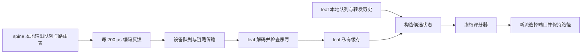

# PRISMA–ConWeave：RL 路由机制、训练方案与实验结果

整理日期：2026-09-16。代码核对版本：`973b70619e089164557ca966047b9d9e6a29b47c`。本文依据当前源码、冻结模型、结果 JSON 和研究记录整理；没有重新训练或重跑大规模仿真。历史实验的二进制与当前 HEAD 不一定相同，结果按对应版本标注。

后续补测：同日按用户要求实际完成 RL 与 ConWeave 对照，见 [独立对照报告](RL_VS_CONWEAVE_COMPARISON.md)。双方同用 DCQCN 时，相对采用历史低速定时参数、状态保留 2 秒的 ConWeave，RL 平均/P99 FCT 下降 20.42%/20.28%，整批完成时间增加 2.93%。这是四个新流量种子的探索性结果；ConWeave 默认配置有失败，不能据此宣称全面超过原参数 ConWeave。下文既有 CONGA 与学习归因数字保持原实验口径。

## 1. 当前项目完成了什么

当前选定方案在源 leaf 交换机收到新流首包时，对可用 spine 路径分别评分，选取最低分路径，随后保持整条流的路径。评分器使用本地队列、收到的远端队列反馈、链路速率和本地流量历史。训练通过全网流完成时间的回报，从零开始学习八个线性系数，再进行小步继续学习。

当前方法属于无模型策略搜索强化学习（model-free policy-search RL）。它不预测网络转移模型，通过在 ns-3 中试运行策略、观察回报来改进参数。执行时采用确定性最低分选路，训练时在参数空间探索。仓库同时保留旧 PRISMA Double DQN 代码，但最新结果来自原生 C++ 评分器和 Python ARS 风格优化器，不能按旧 DQN 描述。

最新严格报文反馈版本在 128 主机非对称拓扑中，相对原参数 CONGA，平均流完成时间（Flow Completion Time，FCT）下降 **21.31%**，P99 FCT 下降 **17.57%**，240 次运行中的全部流均完成。整批完成时间没有统计上成立的整体改善。该比较衡量完整路由方案；可单独归因于继续学习的 **1.41% 平均 FCT、2.00% P99 增量改善**来自修复前的配对对照，修复后尚未重做完整学习归因。

本文的结论范围是既有仿真配置中的有效路由策略。当前证据尚未证明 RL 稳定超过全部同信息强固定规则，也没有证明最新模型在 1024 主机、真实交换机或计入推理时延后仍获得相同收益。

主要证据：[当前策略说明](../prisma/experiments/path_learning/README.md)、[历史模型与对照结果](../prisma/experiments/path_learning/selected.json)、[当前报文版本结果](../prisma/experiments/path_learning/wire-feedback.json)、[完整研究记录](../RESEARCH_HISTORY.md)。

## 2. 网络环境和路由控制范围

### 2.1 实验使用 128 主机、8 leaf、8 spine 的两层拓扑

| 项目 | 当前主实验设置 |
|---|---|
| 节点与链路 | 128 主机 + 16 交换机 = 144 节点，192 条链路 |
| 主机接入 | 每 leaf 连接 16 台主机，主机接入链路 1 Gbps |
| leaf–spine | 每 leaf 上联 8 个 spine；4 条 1 Gbps，4 条 0.5 Gbps |
| 链路传播时延 | 每条链路 1000 ns，即 1 μs |
| 缓冲配置 | `BUFFER_SIZE 50`，实验记录按 50 MiB 表述 |
| 拥塞控制 | DCTCP，`CC_MODE=8`，`HAS_WIN=1`，`VAR_WIN=1` |
| 传输机制 | IRN 开启，PFC 关闭；IRN RTO 为 10/32 ms |
| 数据包载荷设置 | 1000 B |
| 业务时间 | 仿真 2.0 s 开始注入，注入 50 ms，再排空约 1 s |
| 执行随机种子 | 主实验 `RANDOM_SEED=100`；与流量种子、优化种子分开 |
| 当前控制 | `LB_MODE=12`，`RL_SWITCH_MODE=8`；压力观测、迁移门控均关闭 |

拓扑文件 [leaf_spine_128_100G_asym_OS2.txt](../conweave-ns3-main/config/leaf_spine_128_100G_asym_OS2.txt) 中的 `100G` 是历史命名，实际链路是 1/0.5 Gbps。每 leaf 主机侧带宽共 16 Gbps，上联共 6 Gbps，因此按当前文件计算的总带宽比是 16:6；文件名中的 `OS2` 也不应替代实际配置。

`LB_MODE=12` 在辅助脚本中命名为 `oracle`，但当前实验同时开启报文反馈并启用 RL，执行的是收到报文后的缓存路径。代码对 RL 调用远端 oracle 设置了立即报错保护。不能只看枚举名字判定当前策略使用全局真值。

来源：[实验基础配置](../conweave-ns3-main/config/path_learning_base.txt)、[运行配置覆盖与流量生成](../prisma/source/path_rollout.py)、[交换机路由实现](../conweave-ns3-main/src/point-to-point/model/switch-node.cc)。基础配置会被运行脚本覆盖，单看基础文件的 `LOAD` 或 `LB_MODE` 不能确定最终实验。

### 2.2 RL 控制源 leaf 的新流出口

对跨机架流，主要路径为：

```text
源主机 → 源 leaf → 所选 spine → 目的 leaf → 目的主机
                  ↑
             RL 决定这个出口
```

每个候选动作对应源 leaf 的一个合法上行端口，也对应一条经特定 spine 的路径。当前实现最多支持八个候选。目的地址的路由表提供合法候选集合，评分器不生成任意节点序列。

`DiagnosticRoute()` 仅在源 leaf、本机接入源主机、且存在多个下一跳时进行这一决策；单下一跳、非源 leaf 等情况使用原有转发逻辑。同机架流不会为了让 RL 选路而强制绕经 spine。`sweep` 负载还有人为固定路径的背景流，见第 7 节。

已选路径保存于交换机本地流表，流键来自源/目的 IP 和 UDP 端口。模式 8 对已有路径直接复用，不周期性重选、不进行 flowlet 换路，也不按包重新探索。评分器参数在一次运行内冻结，并由各源 leaf 共用；每个 leaf 独立维护自己的反馈缓存和历史。它不是“每台交换机各自在线更新一个 DQN”。

这一控制范围减少了流内换路引起的乱序风险，但也意味着：首选路径后来拥塞时，当前策略不能主动迁移该流；新流决策无法使用最终流大小或未来到达信息。

## 3. State：每条候选路径有哪些可观测信息

### 3.1 当前 actor 使用八个特征

原生接口为每个候选生成 24 个槽位，当前策略只使用索引 `0,1,2,3,5,6,7,8`。若有八条候选，则一次决策生成八份候选状态，逐一调用同一个评分器。

下列公式中：`q_l` 是本地端口输出队列总字节数，`C_l` 是本地链路 bit/s；`q_r` 和 `C_r` 来自已收到的远端报告。时间型特征的数值单位为 **ms**。固定 `L=1000 B` 是估算一个数据包服务时间的参考长度，不是当前流的最终大小。

| 原生索引 | 训练名 | 定义 | 信息来源与边界 |
|---:|---|---|---|
| 0 | `local_delay` | `(q_l + 1000) × 8 × 10³ / C_l` | 本机端口队列和配置速率；包含参考包序列化时间 |
| 1 | `remote_delay` | `(q_r + 1000) × 8 × 10³ / C_r` | 候选 spine 通往目的 leaf 的最近报告；未知时用 `q_r=0, C_r=C_l` |
| 2 | `local_serialization` | `1000 × 8 × 10³ / C_l` | 本地发送参考包的时间 |
| 3 | `remote_serialization` | `1000 × 8 × 10³ / C_r` | 报告中的远端速率；未知时采用本地速率 |
| 5 | `remote_change` | `Δq_r^(200μs) × 8 × 10³ / C_r` | 相邻已收到报告的队列变化，按 200 μs 归一；允许为负 |
| 6 | `local_change` | **恒为 0** | 为兼容训练时的状态保留；当前模型没有获得有效本地趋势信息 |
| 7 | `destination_recent_work` | 候选端口上，发往该目的前缀的近期服务工作量 | 本 leaf 实际观察到并经该端口转发的数据包；指数衰减时间常数 200 μs |
| 8 | `port_recent_work` | 候选端口上所有目的的近期服务工作量 | 本 leaf 的端口历史，时间常数同为 200 μs |

`local_delay` 和 `remote_delay` 是以队列长度/速率构造的服务时间估计，不是 ns-3 提供的未来等待时间真值，也不是端到端 FCT；它们没有直接加入所有主机/交换机跳的传播和处理时间。

`remote_change` 的精确定义为：

```text
Δq_r^(200μs) = (本次量化队列 − 上次量化队列)
              × 200000 ns / (本次发送采样时间 − 上次发送采样时间)
```

仅当连续报告中同一目的前缀匹配、采样时间增加时计算；缺少可用前项时为零。接收端只比较同一发送源的时间差，不用发送端绝对时间判断新鲜度。

近期工作量按已看到的数据包累加：

```text
W(t) = W(t_prev) × exp[−(t − t_prev) / 200 μs]
       + 当前包字节数 × 8 / 当前出口速率
```

累加时用实际包长，包含仿真包头；读取时继续衰减并转换为 ms。目的工作量先按可见目的 IP 保存，再按收到报告中的目的前缀汇总；报告未知时只汇总该目的 IP。它描述过去已处理流量，不是未完成流剩余字节或预知的流大小。

在当前对应路径上，本地与远端链路速率配对相同，两个序列化特征重合；恒零本地变化项也不提供信息。因此“八系数”不等于八个独立有效信号，更不能把每个系数解释为独立因果贡献。

来源：[特征选择与导出](../prisma/source/path_policy_search.py)、[状态构造和工作量更新](../conweave-ns3-main/src/point-to-point/model/switch-node.cc)、[反馈缓存与队列差分](../conweave-ns3-main/src/point-to-point/model/route-feedback.h)。

### 3.2 其余 16 个槽位保留在接口中，但当前 actor 不使用

以下记 `l/r` 为本地/远端延迟，`a` 为报告年龄，`d` 为远端变化，`W_dst/W_port` 为两种近期工作量；这些基础量以 ms 编码。比值和非线性变换为无量纲数，两个时间量相乘的槽位按 ms² 编码。

| 索引 | 槽位内容 |
|---:|---|
| 4 | 报告年龄，截到 2 ms；未知时设 0.2 ms |
| 9 | `l / (l + r + 10⁻⁶)` |
| 10 | `r × min(2,a)` |
| 11 | `d × min(2,a)` |
| 12 | `W_dst × min(2,a)` |
| 13 | `W_port × min(2,a)` |
| 14 | 是否存在未过期的匹配远端报告，0/1 |
| 15 | `tanh(d / 0.05)` |
| 16 | `log(1 + l / 0.016)` |
| 17 | `log(1 + r / 0.016)` |
| 18 | 所有候选的本地+远端估计延迟标准差 |
| 19 | 当前候选相对最低估计延迟候选的差值 |
| 20 | `W_dst / (W_port + 0.001)` |
| 21 | 此端口向该目的前缀上次分配新路径后的间隔，最多 2 ms；未知 0.2 ms |
| 22 | 所有候选的本地+远端估计延迟均值 |
| 23 | 模式 9 的已发送前缀长度变换；模式 8 恒为 0 |

这些槽位在当前发布模型中对应权重为零。特别是报告年龄、是否已知等虽然存在于状态容器中，当前 actor 不会直接利用它们调节置信度。有效与过期判断仍由固定缓存机制执行。

## 4. 远端观测通过真实报文字节进入 leaf

### 4.1 状态传递链路



spine 从自己的路由表构造目的前缀，读取自己的输出队列与端口速率。队列字节向上量化到 1024 B 的倍数，再编码为 IPv4 协议号 `0xF9` 的反馈包。报告包含序号、采样时间、目的网络和前缀长度、量化队列、速率，以及可选 pressure 字段。

leaf 只能在收到并成功解码报文后更新自己的缓存。缓存按接收端口保存，按目的前缀匹配；旧序号或重复序号遭拒绝。本机接收时间决定报告是否过期，TTL 为 `max(1 ms, 5 × 报告周期)`，在当前 200 μs 周期下为 1 ms。超过 TTL 或尚未收到匹配报告时，远端队列按零、远端速率按本地速率估计，趋势按零。

这一回退是信息缺失时的名义估计，并不表示真实远端没有排队。队列量化、采样间隔、传输延迟和报告丢失都可能使信息失真；本机接收时间衡量的是“收到多久”，不等于样本从发送采集到现在的完整年龄。

### 4.2 反馈开销已计入链路，推理时间尚未计入

| 项目 | 当前普通报告 |
|---|---:|
| 固定报文载荷头 | 24 B |
| 每个目的前缀项 | 17 B |
| 当前前缀项数 | 8 |
| 载荷 | `24 + 8 × 17 = 160 B` |
| IPv4 + 仿真链路封装 | 20 B + 14 B |
| 每份报告总长 | **194 B** |
| 报告周期 | 200 μs |
| 每条报告链路带宽 | **7.76 Mbit/s** |
| 占 1/0.5 Gbps 链路比例 | 约 0.776% / 1.552% |

报告经真实设备队列和序列化传输，使用原有控制队列优先级，不能将其描述成与普通数据具有完全相同的准入/丢包待遇。启用 pressure 时，每个前缀多 8 B，报告增至 258 B；当前策略关闭该选项。

原生评分器计算没有增加仿真时间，因而当前结果不包含交换机实际执行神经容器、读写历史表或控制程序运行的时间成本。八系数评分在数学上可简化为点积，但仓库原生推理实际仍执行 24×32×2 容器；目前没有硬件实测。

### 4.3 修复前后的实验必须分开

旧实现已计入占位反馈包的链路传输，但测量值曾通过按 packet UID 索引的全局表传递；还存在直接读取远端路由表/速率和共享时钟年龄的做法。当前修复将测量、速率和前缀写入真实字节，删除观测旁路，并禁止 RL 访问诊断 oracle。

修复沿用三份冻结模型，没有重新学习；普通反馈从旧抽象的 80 B 增至 194 B。整个修复使平均/P99 FCT 相对旧冻结策略增加 0.69%/0.55%，这同时包含字节开销、前缀发现与缓存语义变化，不能单独解释为反馈带宽成本。

来源：[报文实现](../conweave-ns3-main/src/point-to-point/model/route-feedback.h)、[发送/接收/保护逻辑](../conweave-ns3-main/src/point-to-point/model/switch-node.cc)、[报文测试](../conweave-ns3-main/tests/test_route_feedback.cc)、[新 Packet 重建测试](../conweave-ns3-main/tests/test_route_feedback_packet.cc)、[历史修复核验记录](../../../work/prisma_conweave_data/results/rl-wire-feedback-20260913-gu461cjt/verification.json)。

## 5. Action 与策略表示：八系数决定初始路径

令某候选路径的八维输入为 `x`，训练校准得到的 RMS 尺度为 `s`，可训练参数为 `θ`。评分公式是：

```text
score_θ(x) = Σ(j=1…8) θ_j × x_j / s_j
动作 a = argmin(候选路径 p) score_θ(x_p)
```

分数越低越优。初始 `θ=0`，所有候选同分；代码先用可见流头的确定性哈希轮转候选顺序，再选择第一个最低分项。比较容差为 `10⁻¹²`。这避免零权重始终选同一个端口，同时也意味着初始动作是哈希式分散。

所有系数允许正负，没有固定“本地队列权重必须为正”之类约束，也没有把专家分数与学习分数相加。观测定义、历史衰减、路径保持和候选集合仍由人工设计。

模型导出采用 `ROUTE_DQN_V1 24 32` 格式：24 维输入、32 个 ReLU 隐藏单元、2 个输出。原生路径分数取输出 1 减输出 0。导出器把 `θ/s` 写入权重；对可能为负的变化量用 `ReLU(x)−ReLU(−x)=x` 精确表示线性项。其余非负特征直接通过 ReLU。

**这只是线性评分的兼容容器。** 当前训练没有优化隐藏表示，没有 TD loss、经验回放、target network、Bellman bootstrap 或逐状态 epsilon 探索。附属 `.npz` 中的 `gamma=1`、`step=0` 是格式元数据，不代表当前训练实施 DQN。当前新流动作也不是“保持/切换”两个动作；两个输出用于计算一个候选分数，实际动作是候选端口索引。

来源：[参数与模型导出](../prisma/source/path_policy_search.py)、[`ChoosePath()`](../conweave-ns3-main/src/point-to-point/model/route-learning.inc)。

## 6. Reward 和训练算法

### 6.1 回报直接使用整次网络运行的平均/P99 FCT

一次 rollout 指固定一个策略、一个流量种子和一种负载，运行完整网络仿真并检查流完成情况。每次扰动策略在四类训练负载各运行一次。

对完成全部流的负载 `f`，定义：

```text
R_f = −100 × [ ln(mean_FCT_f / 1 ms)
               + 0.25 × ln(P99_FCT_f / 1 ms) ]
R = (R_uniform + R_storage + R_sweep + R_mixed) / 4
```

代码使用自然对数。回报越大越好；它同时惩罚平均时延与尾时延，在对数尺度上平均 FCT 权重为 1、P99 为 0.25。四种负载等权，因此高流数负载不会仅因流数多而占据更大训练权重。`sweep` 的固定背景流同样计入全网指标。

排空期限内仍有未完成流时，该负载记 **−10000**，再参与四负载平均；不会只对已完成的流计算漂亮的低 FCT。模拟器崩溃、异常退出、数据校验错误会中止流程，不当成正常低回报。历史首批 384 次运行中 28 次未完成，研究记录说明在首次更新前补充了这一完成性惩罚，之后按冻结协议继续。

最终 FCT、完成数和全网聚合只供离线训练/评价使用，不是部署时提供给新流 actor 的输入。原生 `transitions.csv` 保存的持续时间也不是当前 ARS 优化器直接使用的 reward；优化器读取完整 rollout 的统计结果。

### 6.2 从零校准只估计输入尺度

校准使用流量种子 `81000`，在四类训练负载上运行零权重策略，收集所有候选状态：

```text
s_j = max(sqrt(mean(x_j²)), 10⁻⁶)
```

这是 RMS 缩放，不减均值，不从专家动作或专家 FCT 推导权重。尺度在训练前冻结。校准还检查零权重 mode 8 与 mode 9 保持路径是否产生相同 FCT，以及两种固定规则导出方式是否等价。

### 6.3 ARS 风格的成对扰动更新

每个优化种子维护一个八维参数向量。每轮执行：

1. 采样 8 个高斯方向 `d_i`。
2. 为每个方向构造 `θ_i⁻ = θ − σd_i`、`θ_i⁺ = θ + σd_i`。
3. 每个正/负扰动分别运行四类负载，得到 `R_i⁻, R_i⁺`。正负扰动使用相同流量条件。
4. 按 `max(R_i⁻, R_i⁺)` 排序，选最好的 4 个方向。
5. 用所选 8 个回报的标准差归一化，计算更新。
6. 限制更新向量范数，再将中心参数投影到对称单位球内。

公式为：

```text
σ_R = max(0.1, std(所选方向的正/负回报))
Δθ = α × mean_i[(R_i⁺ − R_i⁻) × d_i] / σ_R
Δθ ← Δθ × min(1, cap / max(||Δθ||₂, 10⁻¹²))
θ_new ← (θ + Δθ) / max(1, ||θ + Δθ||₂)
```

这是对回报敏感方向的无导数策略搜索。单位球投影约束更新后的中心，代码没有单独将每个扰动候选投影回单位球。每轮还对更新后的中心跑四类负载用于监测，但模型选择采用另设的验证集。

### 6.4 两阶段训练的全部主要超参数

| 设置 | 从零阶段 | 继续学习阶段 |
|---|---|---|
| 优化种子/训练谱系 | 9101、9102、9103 | 延续同三个谱系 |
| 实验组 | `real`、`shuffled` | `real`、`shuffled` |
| 初始参数 | 八个系数全零 | 从零阶段选中的三个第 12 轮模型 |
| 训练轮数 | 12 | 24 个追加轮次 |
| 每轮方向/入选方向 | 8 / 4 | 8 / 4 |
| 每方向运行 | 正负各四负载，共 8 次 | 相同 |
| 扰动尺度 `σ` | 第 1–4 轮 0.35；5–8 轮 0.15；9–12 轮 0.05 | 第 1–8 轮 0.03；9–16 轮 0.012；17–24 轮 0.004 |
| 更新步长 `α` | 0.12 | 上述三段分别 0.03、0.015、0.0075 |
| 更新范数上限 `cap` | 0.30 | 上述三段分别 0.10、0.06、0.03 |
| 中心参数范数 | θ 的 L2 范数 ≤1 | 相同 |
| 每组扰动运行总数 | `3×12×8×2×4 = 2304` | `3×24×8×2×4 = 4608` |
| 每组中心监测运行 | 144 | 288 |
| 每组候选模型验证运行 | 180 | 240 |
| 固定规则验证预算 | 324 次 | 432 次 |

“每组”指三个优化种子合计；`real` 和 `shuffled` 各占一组，不能把 2304/4608 当作两组总预算。运行器默认最多 20 个并行仿真进程，每个任务设 1800 s 墙钟超时；这些是实验调度参数，不是网络时间或 RL 超参数。

继续学习根据上一阶段第 12 轮 `real` 的 12 条**训练中心轨迹**统计观测 RMS，得到固定探索缩放：

```text
factor_j = clip(原校准 RMS_j / 新观测 RMS_j, 0.25, 4)
d_i,j = Normal(0,1) × factor_j
```

恒零信号的方向缩放直接设为零。旧输入归一化 `s` 和起点模型分数保持不变，改变的是参数探索方向。该阶段没有读取验证/测试分布来重新归一化。

最终冻结的探索缩放按八特征顺序约为 `[4.0, 3.052973, 1.0, 1.0, 1.077543, 0.0, 0.982699, 1.022135]`，完整精度见 [selected.json](../prisma/experiments/path_learning/selected.json)。

来源：[从零训练](../prisma/scripts/learn_path_from_scratch.py)、[继续学习](../prisma/scripts/continue_path_learning.py)、[更新函数](../prisma/source/path_policy_search.py)、[探索尺度计算](../prisma/source/path_policy_refinement.py)。

### 6.5 打乱奖励组检验“奖励与动作对应关系”是否有效

`shuffled` 与 `real` 使用相同起点、方向采样机制、运行数量、优化步骤和验证预算。不同之处是每轮把自己测得的 16 个正/负扰动回报随机重排，再将错误对应的回报交给同一个更新函数。

这样比较的是：正常的策略–回报对应关系是否带来收益。打乱组仍执行真实仿真、仍拥有相同观测，不是少训练或删除状态。继续学习中两组均从相同三个已学模型开始；两组中心后来可能不同，因此各自测量自己的扰动回报。

从零阶段的打乱组最终由验证选择零权重起点；继续学习的打乱组选择保留原起点。因此报告中相对 `start` 与相对 `shuffled` 的增量结果相同，不代表比较时误用了同一标签。

### 6.6 验证统一选轮次，测试保留全部三个谱系

| 用途 | 从零阶段 | 继续学习阶段 |
|---|---|---|
| 校准/启动校验 | 81000 | 83999，仅验证拷贝模型与原模型等价 |
| 训练流量种子 | 81001–81012，每轮一个 | 84001–84024，每轮一个 |
| 验证流量种子 | 82001–82003 | 85001–85004 |
| 候选轮次 | 初始、1、4、8、12 | 追加 0、6、12、18、24 |
| 正常组所选轮次 | 第 12 轮 | 追加第 18 轮，即 `real_r17` |
| 独立测试流量种子 | 83001–83008 | 86001–86012 |
| 训练/验证负载 | uniform、storage、sweep、mixed | 相同 |
| 测试负载 | 上述四类 + mixed_fast | 相同 |

每个实验组跨三个谱系、全部验证种子和四类负载统一选一个轮次，最大化同一回报。没有为每个负载选专属模型，也没有挑一个测试最好的谱系作为最终结果。继续学习实际跑完 24 轮，只发布验证选中的追加 18 轮模型；其训练谱系可追溯到 12+18 轮更新。

测试流量在模型选择冻结后生成。最新反馈修复复测复用了继续学习阶段的留出种子和冻结模型，用于实现修复核验；它不是新的一套未曾使用的泛化测试集。

## 7. 训练与测试流量

| 负载 | 生成方法与用途 |
|---|---|
| `uniform` | 随机源/目的，泊松到达；包流大小 2000/8000/64000/256000 B，概率 0.50/0.35/0.10/0.05；到达率按 `128×0.35 Gbps/(23000×8)` 设置 |
| `storage` | 仓库 `AliStorage2019.txt` 流大小 CDF，使用流量生成器的 0.35 负载参数、1 Gbps 参考带宽、128 主机 |
| `sweep` | 前景源 0–15 发往目的 16–31；额外两机架背景源汇聚到该目的机架；每 500 μs 一阶段，背景流按阶段固定到轮换 spine；背景流仍纳入全网统计 |
| `mixed` | 流大小 2000/8000/64000/1048576 B，概率 0.50/0.35/0.13/0.02；按平均大小设置名义 0.30 负载；热点机架及热点概率随阶段变化，阶段 1–5 ms |
| `mixed_fast` | 与 mixed 相同的大小/负载设计，热点变化加快至 0.2–1 ms；仅用于测试 |

`uniform` 到达率分母固定为 23000 B，而其大小分布的数学期望为 23000 B，二者一致。`mixed` 使用实际期望流大小计算到达率。上述名义负载以主机侧参考带宽定义，不等于每条瓶颈链路的利用率。

`sweep` 是受控隐藏下游热点场景，不能声称所有背景流也由 RL 自由选路；`mixed`/`mixed_fast` 更接近每条流均能自由路由的变化热点场景。这些工作负载提供当前范围内的测试，不等价于覆盖真实数据中心全部业务或 AI collective。

来源：[`trace()`](../prisma/source/path_rollout.py)、[Storage CDF](../conweave-ns3-main/traffic_gen/AliStorage2019.txt)。

## 8. 冻结模型的归一化与系数

下表是 [selected.json](../prisma/experiments/path_learning/selected.json) 中的参数，按六位小数展示；复现必须读取原始完整精度值。`θ` 作用于 `x/s`，原生文本权重已经折入 `1/s`，不能加载后再除一次 RMS。

| 特征 | RMS 尺度 s | θ：9101 | θ：9102 | θ：9103 |
|---|---:|---:|---:|---:|
| local_delay | 0.299994 | 0.651768 | 0.424071 | 0.534796 |
| remote_delay | 0.354507 | 0.707855 | 0.818926 | 0.723995 |
| local_serialization | 0.012649 | 0.069066 | -0.018902 | 0.225639 |
| remote_serialization | 0.012649 | 0.080837 | 0.213826 | -0.100604 |
| remote_change | 0.042964 | -0.018441 | -0.005207 | -0.022525 |
| local_change | 0.000001 | 0.053743 | -0.012975 | -0.117977 |
| destination_recent_work | 0.036499 | -0.011158 | -0.010624 | 0.002944 |
| port_recent_work | 0.144911 | 0.171788 | 0.321149 | 0.158462 |

三个模型都较明显地赋予本地/远端延迟正权重，但不能直接用不同量纲或缩放下的系数大小判断重要性。本地变化项虽可能存有非零系数，输入恒零，所以对动作没有直接作用；继续学习仅停止该维探索，并不删除历史系数。

发布文件是 [real-s9101.txt](../prisma/experiments/path_learning/policies/real-s9101.txt)、[real-s9102.txt](../prisma/experiments/path_learning/policies/real-s9102.txt)、[real-s9103.txt](../prisma/experiments/path_learning/policies/real-s9103.txt)。三份模型分别运行和统计，没有三模型投票或集成决策。

## 9. 最终效果：当前报文版本与学习归因分开报告

### 9.1 指标与统计口径

- **平均 FCT**：一次运行中所有流 FCT 的算术平均。
- **P99 FCT**：一次运行全部流 FCT 的 99 分位，代码用 `np.percentile`。
- **CVaR99**：最慢 `ceil(流数×1%)` 条流 FCT 的平均值。
- **最大 FCT**：该次运行最慢一条流的 FCT。
- **整批完成时间（makespan）**：最后完成时刻减仿真 2.0 s 的业务注入起点，包含到达过程；不等于最大 FCT。
- **完成性**：提供流数与完成流数逐一匹配；主结果要求每次运行全部流完成。

相对变化按同一流量条件的指标比例做几何汇总：

```text
变化百分比 = 100 × [ exp(mean(log(指标_RL / 指标_对照))) − 1 ]
```

负数表示耗时下降。它不是把所有运行的 FCT 拼成一个大样本，也不是把绝对均值先跨运行算术平均再相除。P99 结果是“每次运行 P99 的配对比例”，不能当作全体合并流的单一 P99。

最新/继续学习实验采用 10000 次配对 bootstrap：以 12 个流量种子为块，跨五类固定工作负载共同重采样，再配对重采样三个模型谱系。区间反映这些测试条件下的不确定性；三个谱系共享训练流量，区间不覆盖重新生成训练数据、重新验证选点的完整不确定性。

### 9.2 当前严格报文版本相对原参数 CONGA

| 指标 | 相对 CONGA 的变化 [95% CI] |
|---|---:|
| 平均 FCT | -21.31% [-21.62%, -20.90%] |
| P99 FCT | -17.57% [-18.03%, -17.02%] |
| 整批完成时间 | -1.57% [-3.55%, +0.40%] |

测试为 `5 类负载 × 12 个流量种子 × (3 个 RL 模型 + 1 个 CONGA) = 240 次`。RL 180 次，共 1,332,357 条提供流全部完成；CONGA 60 次，共 444,119 条全部完成。总计 1,776,476 是各方法/谱系运行的流实例总数，不是互不重复的业务 trace 数。60 份 CONGA FCT 日志与修复前逐字节一致。

逐负载结果如下，仍为相对 CONGA 的耗时变化：

| 负载 | 平均 FCT | P99 FCT | 整批完成时间 |
|---|---:|---:|---:|
| uniform | -48.03% | -47.57% | -8.51% |
| storage | -13.27% | -8.45% | +0.39% |
| sweep | -5.09% | -2.72% | -1.29% |
| mixed | -17.47% | -9.39% | +2.84% |
| mixed_fast | -14.53% | -10.05% | -0.89% |

五类负载的平均/P99 汇总均改善，其中 uniform 改善最大；sweep 的改善较小。storage 与 mixed 的整批完成时间增加，且整体 makespan 置信区间跨零，因此不能写“所有负载、所有指标均更好”。

对照保留仓库 CONGA 的原参数：DRE 时间常数 50 μs、flowlet gap 100 μs、老化 500 μs，保留其原有 UDP 反馈；没有新增 ACK/NACK 反馈，也没有为这组比较调优 CONGA。当前 RL 与 CONGA 的反馈、选路粒度和状态构造不同，所以这张表衡量系统方案差异。

来源：[当前结果清单](../prisma/experiments/path_learning/wire-feedback.json)、[完整结果汇总](../../../work/prisma_conweave_data/results/rl-wire-feedback-20260913-gu461cjt/summary.json)。

### 9.3 从零训练确实学到有效选路，但当时尚未追平强规则

以下是**旧反馈抽象**下的从零训练留出结果，测试种子为 83001–83008：

| 对照 | 平均 FCT 变化 | P99 FCT 变化 |
|---|---:|---:|
| 零权重/验证选中的打乱奖励组 | −43.23%，95% CI [−43.88%, −42.60%] | −41.58%，[−43.60%, −39.60%] |
| 原人工规则 | +1.46% | +1.82% |
| 验证选定强固定规则 | +1.72% | +3.01% |

这支持“从零、仅根据完成回报可以学会有效路径评分”，但不支持“从零 RL 已超过可用规则”。零权重是弱哈希起点，相对它的大幅改善不应替代与强规则的比较。

来源：[从零统计](../../../work/prisma_conweave_data/results/cable-rl128-from-scratch-20260913/test-statistics.json)、[从零结论](../../../work/prisma_conweave_data/results/cable-rl128-from-scratch-20260913/conclusion.json)。

### 9.4 继续学习取得可归因增量，整体与强固定规则相近

以下同样是**旧反馈抽象**下、种子 86001–86012 的继续学习测试：

| 对照 | 平均 FCT 变化 [95% CI] | P99 FCT 变化 [95% CI] |
|---|---:|---:|
| 同谱系起点 | -1.41% [-1.68%, -1.10%] | -2.00% [-2.67%, -1.39%] |
| 匹配打乱回报续训 | -1.41% [-1.68%, -1.10%] | -2.00% [-2.67%, -1.39%] |
| 原人工规则 | -0.01% [-0.27%, +0.27%] | -0.10% [-1.05%, +0.84%] |
| 前阶段验证选定规则 | -0.02% [-0.28%, +0.27%] | +0.64% [+0.05%, +1.38%] |
| 本阶段验证选定规则 | -0.23% [-0.45%, -0.01%] | +0.41% [-0.29%, +1.13%] |
| 原参数 CONGA（旧反馈结果） | -21.85% [-22.15%, -21.51%] | -18.02% [-18.62%, -17.41%] |

对照含义如下：`start` 是同谱系第 12 轮起点；`shuffled` 是相同起点和预算的打乱回报续训；`original_fixed` 是 `local + 0.25 remote + 0.1 port_work`；`previous_fixed` 与 `strong_fixed` 分别是前阶段和本阶段验证选中的固定规则。

固定规则网格为：

```text
score = local + α×remote + β×port_work + α×τ×remote_change×age
α ∈ {0.125, 0.25, 0.5}
β ∈ {0.05, 0.1, 0.2}
τ ∈ {−0.5, 0, 0.5}
```

共 27 个候选，使用与 RL 相同的信息、反馈和整流保持机制。本阶段固定规则验证跑 432 次，比任一学习组的 240 次验证更多。这个调参针对项目内部规则对照，不是调 CONGA。

前阶段选中 `(α,β,τ)=(0.5,0.1,−0.5)`，本阶段选中 `(0.5,0.2,−0.5)`。对应选择证据为 [从零阶段选择](../../../work/prisma_conweave_data/results/cable-rl128-from-scratch-20260913/final-selection.json) 和 [继续学习选择](../../../work/prisma_conweave_data/results/cable-rl128-continued-learning-20260913/final-selection.json)。

预先规定的增量学习门槛要求：相对起点和打乱组，平均 FCT 变化的 95% 上界小于零；同时相对起点 P99 的上界小于 +1%。匹配强规则的非劣门槛要求：相对三个规则，平均/P99 上界分别小于 +1%/+2%。继续学习通过这两类门槛，但没有通过“相对全部三个规则的平均 FCT 上界均小于零”的严格超越条件。

全部 780 次测试、5,773,547 个流实例均完成。事后按流大小分组，≤8 KB 小流相对起点的平均 FCT/P99 为 +0.17%/+2.13%，因此总体改善没有保证每类流都更快。实验没有设置同预算但不调整探索尺度的正常奖励组，不能把增量收益进一步分解为“多训轮数”和“探索尺度调整”各自的贡献。

当前报文修复后只复测冻结 RL 与 CONGA，未重做上述起点、打乱和强规则对照。因此严格可写的是：**旧抽象中已证实奖励学习的增量作用；新实现中已确认完整方案相对 CONGA 的优势仍存在。**

来源：[历史结果与预设结论](../prisma/experiments/path_learning/selected.json)、[继续学习统计](../../../work/prisma_conweave_data/results/cable-rl128-continued-learning-20260913/test-statistics.json)。

## 10. 项目还保留哪些 RL 路线，为什么最终选当前方案

### 10.1 早期 PRISMA/v8 使用真正的 Double DQN

这一版本入口是 [prisma/main.py](../prisma/main.py)，由 ns-3/OpenGym、ZeroMQ/Protobuf 与 Python/TensorFlow agent 交互。它与当前原生评分训练是两条不同管道。

| 项目 | 旧 `rl-core-v8` 的源码设计 |
|---|---|
| 决策粒度 | 源 leaf 的 flowlet 边界请求新动作，同一 flowlet 延续路径 |
| agent | 每个 leaf 的 Python agent，输出本地上行端口索引 |
| state | `[目的 overlay ID, 上次动作, 每端口六项特征]`，维数 `2+6N`；N=8 时为 50 |
| 六项特征 | 瞬时队列占用、队列 EMA、DRE 利用率、队列趋势、容量感知 headroom、相对链路容量 |
| 输入编码 | 六项特征按 5000 编码成整数，Python 统一除 5000；目的 ID 保留整数语义；上次动作归一化后在 v8 评分器中排除 |
| Q 网络 | 目的 one-hot→16 维上下文；候选端口平均池化→16 维上下文；共享动作网络 64→32→tanh；共同状态值分支 |
| Q 结构 | `Q(s,a)=V(s)+P_native(s,a)+0.1×tanh(Rθ(s,a))` |
| 固定先验 | `0.6×headroom + 0.2×(1−queue_ema) + 0.1×(1−queue) + 0.1×(1−trend)` |
| 动作选择 | epsilon-greedy，贪心选 **最大 Q**；与当前最低路径成本不同 |
| 训练 | Double DQN、Huber loss、Adam、经验回放、按梯度步硬更新 target |

`headroom = (端口速率/本 leaf 最快速率) × (1−DRE 利用率)`，所以先验区分快慢链路剩余服务能力。候选动作网络共享权重，减少依赖固定端口编号的机会；公共 `V(s)` 不改变同一状态下的动作排序。残差限制为 ±0.1，先验仍能主导选择。

旧 v8 即时奖励采用同组四个本地信号：

```text
r_inst = 0.6×headroom + 0.2×queue_health_EMA
         + 0.1×instant_queue_health + 0.1×trend_health
r = α×r_inst + (1−α)×r_prev，α 默认 0.7
```

随后训练将 reward 裁到 [−1,1]，使用在线网络选下一动作、target 网络评价：

```text
a_next = argmax_a Q_online(s_next,a)
y = clip[r + γ×(1−done)×clip(Q_target(s_next,a_next),−10,10), −10,10]
```

这类局部健康度奖励与当前完整 FCT 回报不同，不能把旧 reward 曲线上升直接解释成全网 FCT 改善。

源码默认训练参数为：学习率 `10⁻⁴`、batch 256、γ=0.9、回放容量 50000、每节点 256 样本后开始训练、每新增 4 个样本更新一次、每 100 次梯度更新同步 target；epsilon 从 1.0 降至 0.1，默认调度 8000 步；冻结评估 epsilon=0。它们是解析器默认值，不是所有历史运行的实际配置。target 初始化复制 online；训练结束前补齐样本数要求的更新；旧 ECMP imitation 参数已禁用。

主要修复经历包括：目的 ID 被缩放后取整而坍缩、观测接入未维护的 CONGA 统计、端口特征未接入网络、transition 对齐错位、容量读取固定 1 Gbps、时间戳先更新使趋势恒零、flowlet 动作复用语义不清等。修复这些错误建立可检查的学习闭环，但不能单凭修复清单证明性能优势。

旧冻结 v8 在部分配对 FECMP 轨迹上改善过 FCT；后续与更强 CONGA/容量规则比较，发现固定先验可追平甚至更好。早期某些 100 ms 对照还有未完成流，仅比较共同完成流存在选择偏差。详细历史见 [研究记录第 4.0 节](../RESEARCH_HISTORY.md)。

代码入口：[状态契约](../prisma/source/rl_contract.py)、[网络结构](../prisma/source/models.py)、[Double DQN 更新](../prisma/source/trainer.py)、[优化器与损失](../prisma/source/learner.py)、[参数默认值](../prisma/source/argument_parser.py)、[旧观测/奖励实现](../conweave-ns3-main/src/opengym/model/conweave-obs-manager.cc)。

### 10.2 换路、迁移门控与 pressure 没有成为当前默认方案

| 研究阶段 | 做法 | 结果及最终处理 |
|---|---|---|
| 容量先验与 1024 主机 | 固定规则感知快慢链路；扩展到 64 leaf、8 spine | 固定先验相对 CONGA 平均/P99 −5.71%/−0.63%；测试对象并非当前八系数 RL |
| 受控瓶颈诊断 | 分别干预远端可见性、报告延迟、逐包迁移 | 信息、延迟、乱序成本有交互；理想 oracle 结果只能用作诊断 |
| mode 1–7 换路学习 | 先提出替代路径，再学习保持/切换；状态从 16 维扩为 24 维并纳入传输信号 | 535 次测试中，相对同信息整流保持规则没有稳定平均 FCT 收益 |
| 初始路径非线性学习 | 从“何时切换”转向“新流走哪条路” | 1300 次主测试；相对强规则平均约 −0.037%、P99 +0.094%，未证实独立优势 |
| mode 9 安全迁移 | 已观察发送 ≥64 KB、未确认量 ≤8 KB、间隔 ≥50 μs，至多一次迁移 | 最慢 1% 和最大 FCT 有局部改善，但平均/P99 未稳定改善，强规则仍更好 |
| 独立迁移价值门控 | 对旧/新路径和传输上下文学习迁移收益 | 相对旧固定门控平均/P99 +1.10%/+1.33%，整批/最大 FCT −3.37%/−6.20%，存在取舍 |
| 迁移强度 | 对 25%/50%/100% 流量准入进行干预 | 高强度迁移伤害无迁移资格的小流；减少准入又损失整批收益，未通过验证约束 |
| pressure 观测 | 旧/新路径本地/远端前缀包排队字节与排队流数，共增加八项 | 与同信息开销 masked 对照比较无稳定净收益；当前关闭 |
| 人工规则起点策略搜索 | 从强规则出发搜索线性/固定 ReLU 系数 | 正常/打乱回报差异未稳定成立，整体胜过 CONGA 不能证明学习有效 |
| 从零 + 继续学习 | 八个零系数起点、整网回报、严格打乱对照 | 成为当前发布策略，学习归因见第 9 节 |

旧 mode 9 可支持排空 ACK 边界、flowlet gap 或受限未确认量边界重选；迁移 gate 使用旧/新路径特征、已发送前缀、未确认量、ACK 年龄、ACK 速率、流年龄、包间隔和 NACK 近期性。pressure 根据已看到的包序号 `<8000` 识别前缀包，不读取最终流大小。它们都保留在代码中供研究，不代表当前 mode 8 模型使用这些能力。

这些结果共同促成了当前设计：先保持流内路径，把学习集中在可获得观测下的新流初始分配，再用全网回报和匹配对照确认增量。源码机制见 [route-learning.h](../conweave-ns3-main/src/point-to-point/model/route-learning.h) 与 [route-learning.inc](../conweave-ns3-main/src/point-to-point/model/route-learning.inc)；历史数值见 [研究总记录](../RESEARCH_HISTORY.md)，不与最新报文结果混算。

## 11. 如何定位代码、模型和数据

| 文件/目录 | 内容 |
|---|---|
| [path_policy_search.py](../prisma/source/path_policy_search.py) | 八维策略、线性导出、整网 reward、成对扰动更新 |
| [path_policy_refinement.py](../prisma/source/path_policy_refinement.py) | 继续学习探索尺度 |
| [learn_path_from_scratch.py](../prisma/scripts/learn_path_from_scratch.py) | 校准、从零训练、验证、测试与消融入口 |
| [continue_path_learning.py](../prisma/scripts/continue_path_learning.py) | 继续学习和模型选择 |
| [path_rollout.py](../prisma/source/path_rollout.py) | 流量生成、运行配置、仿真调度、完成性审计和指标 |
| [switch-node.cc](../conweave-ns3-main/src/point-to-point/model/switch-node.cc) | 反馈发送/接收、候选状态、路径保持与实际路由 |
| [route-feedback.h](../conweave-ns3-main/src/point-to-point/model/route-feedback.h) | 反馈字节协议、缓存、过期与前缀发现 |
| [route-learning.inc](../conweave-ns3-main/src/point-to-point/model/route-learning.inc) | 模型加载、评分、决策与日志 |
| [path_learning/](../prisma/experiments/path_learning/) | 三份当前冻结模型、历史 manifest、当前报文复测结果 |
| [外部 results/](../../../work/prisma_conweave_data/results/) | 历史小型结果、协议、选择、审计和 CSV |
| [外部 archives/](../../../work/prisma_conweave_data/archives/) | 原始 FCT、轨迹、模型、源码/二进制快照的压缩包 |
| [catalog/results-index.json](../../../work/prisma_conweave_data/catalog/results-index.json) | 结果搬迁路径与哈希索引 |

外部数据根为 `/home/gengjiayao/ict/work/prisma_conweave_data`。这些相对链接适用于当前目录布局；单独复制代码仓库时，外部原始数据不会自动跟随。历史 JSON 中的旧绝对路径保留来源意义，需要按索引映射。

## 12. 复现实验的入口与检查条件

### 12.1 新训练使用当前源码与独立输出目录

当前 ARS 管道需要 Python 3、NumPy 和兼容的原生 ns-3 二进制。它不依赖旧 TensorFlow DQN 来更新八系数，但原生工程构建仍需项目的 ZeroMQ、protobuf 等依赖。先执行工程 configure，生成 `messages.pb.cc/.h`，再构建 `scratch/network-load-balance`。构建与依赖细节见 [当前运行说明](../prisma/experiments/path_learning/README.md)。

不要仅凭 `build/scratch/network-load-balance` 文件存在就认定其包含当前代码：仓库可能残留旧构建产物。新运行应记录源码、二进制、模型、拓扑、配置与流量哈希，并在独立目录输出。

以下从仓库根执行；`NS3_BINARY` 必须替换为已核验兼容的实际构建路径：

```bash
export NS3_BINARY=/absolute/path/to/current/build/scratch/network-load-balance
export RUN_ROOT=/home/gengjiayao/ict/work/prisma_conweave_data/new_runs/my_path_learning

python3 prisma/scripts/learn_path_from_scratch.py \
  --experiment-dir "$RUN_ROOT/from_scratch" \
  --ns3-binary "$NS3_BINARY" --stage all

python3 prisma/scripts/continue_path_learning.py \
  --experiment-dir "$RUN_ROOT/continued" \
  --ns3-binary "$NS3_BINARY" \
  --previous-experiment "$RUN_ROOT/from_scratch" --stage all
```

从零阶段可单独执行 `calibrate/train/validate/test/ablate`；继续学习为 `setup/train/validate/test`。继续学习依赖完整从零产物，尤其是 `train-round11.json` 及对应真实训练中心候选轨迹，仅拷贝三份文本策略不足以重新计算探索尺度。

当前脚本运行新训练时使用修复后的报文实现，而已发布模型是在旧反馈抽象下训练后冻结复测的。因此运行以上命令属于**新训练实验**，不能保证逐位重现历史模型或自动得到本文旧学习归因数字。

### 12.2 只评价已有模型的最小示例

```python
# 在仓库根执行；输出目录应全新，二进制须与当前配置兼容。
from pathlib import Path
import sys
sys.path.insert(0, str(Path("prisma/source").resolve()))
import path_rollout as env

root = Path.cwd()
env.configure(
    "/home/gengjiayao/ict/work/prisma_conweave_data/new_runs/frozen_eval",
    "/absolute/path/to/current/build/scratch/network-load-balance",
)
policy = root / "prisma/experiments/path_learning/policies/real-s9101.txt"
jobs = [
    env.make_trial("rl_uniform_86001", "uniform", 86001,
                   "real", "test", model=policy, fit=9101),
    env.make_trial("conga_uniform_86001", "uniform", 86001,
                   "conga", "test", conga=True),
]
rows = env.execute_jobs(jobs)
assert all(r["valid"] and r["completed"] == r["offered"] for r in rows)
for r in rows:
    print(r["name"], r["all_mean_us"], r["all_p99_us"], r["makespan_us"])
```

该示例只检查一组配对流量的运行，不代替完整 240 次统计。完整当前比较需循环五类负载、十二个流量种子和三个冻结模型，并为每组流量运行一次 CONGA；再按第 9.1 节的配对口径汇总。

运行会留下 `job.json`、`config.txt`、`status.json`、FCT 输出、结果 JSON、候选/transition CSV 和 audit。模式 8 应满足每个被控制流只有终止 transition、无中途重选、`route_changes=0`；所有 offered flow 都必须找到对应完成记录。

### 12.3 历史精确复现需要恢复对应归档

只检查既有结论时优先读取小型 JSON，无须解压全部原始轨迹。需要核验历史训练过程时，从相应 `.tar.zst` 中恢复冻结脚本、二进制依赖、训练记录、流量和模型到独立目录。

```bash
tar --zstd -tf \
  /home/gengjiayao/ict/work/prisma_conweave_data/archives/cable-rl128-continued-learning-20260913.tar.zst
```

列出成员后按需读取，不直接覆盖当前工程。归档的历史源码/路径哈希与发布脚本重构后的哈希可能不同，应保留来源链，而不是将历史哈希失配解释为模型结果自动无效。

## 13. 当前可以下的结论和仍需补齐的证据

| 问题 | 现有证据给出的答案 |
|---|---|
| RL 是否真的学习了路径评分？ | 是。从零正常回报组优于零权重/打乱组；继续学习又优于相同起点与打乱对照，证据来自旧反馈抽象 |
| 当前策略运行是否需要远端真值旁路？ | 不需要。远端观测经真实报文字节到达，RL 访问 oracle 会报错 |
| 当前完整方案是否优于原参数 CONGA？ | 在现有 128 主机、五类负载测试中，平均/P99 FCT 汇总改善；整批完成时间没有确定的整体改善 |
| 约 21% 的收益是否全由 RL 学习贡献？ | 不能如此归因。反馈、历史、保持粒度、评分结构共同构成系统差异 |
| 学习是否不可被简单规则替代？ | 尚未证明。继续学习与同信息强规则总体相近 |
| 是否证明换路学习有效？ | 当前成功证据集中在初始路径选择；迁移路线有负面结果和平均/尾部取舍 |
| 当前是深度强化学习模型吗？ | 当前有效可训练部分是八个线性系数；旧 v8 才训练神经残差 |
| 是否已验证当前模型在 1024 主机上有效？ | 没有；已有 1024 主机结果主要属于历史固定先验或旧换路研究 |
| 是否已完成与 ConWeave 的直接比较？ | 同日补测已完成相同 DCQCN 设置的条件对照，详见独立报告；默认 ConWeave 有失败，可完整运行的低速适配版本与 RL 存在平均/整批时间取舍 |
| 是否可直接宣称硬件可部署？ | 不能。真实报文来源约束已实现，但尚无硬件推理、存储资源和时延验证 |

若继续研究，最直接的证据缺口是：在严格报文实现上重做从零/续训与同信息强规则归因；将同日 ConWeave 探索性对照扩展到更广的规模、带宽和执行种子，补上推理开销、流大小分组和未完成流审计。这些扩展仍是待做工作。
